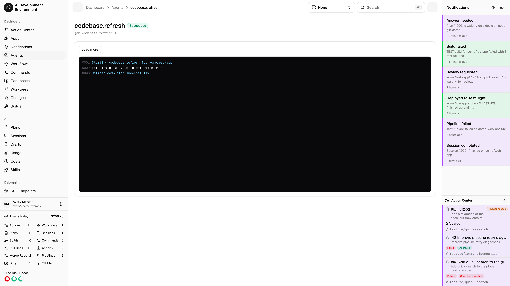
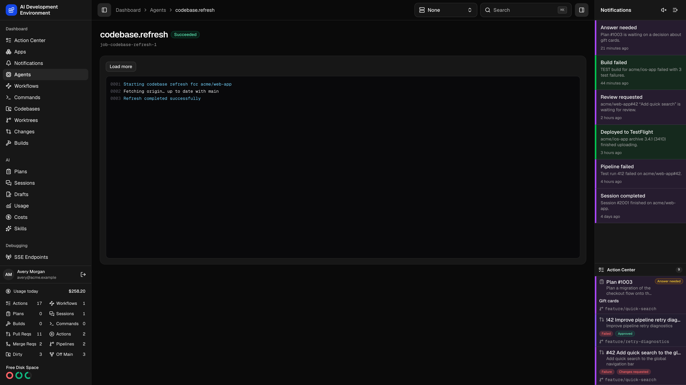

<Frame>
  
  
</Frame>

The job details page at `/dashboard/jobs/{id}` shows one durable job on an agent: its kind, its status, its error if it has one, and its full log stream as it arrives.

Jobs are the unit of work the control plane hands to an agent. Nearly every Git operation, codebase scan, worktree move, and build step in the product runs as a job, so this page is where you go when you need to see exactly what a Mac did.

Tailscale fleet management uses three typed kinds: `tailscale.serve.inspect.v1`, `tailscale.serve.upsert.v1`, and `tailscale.serve.remove.v1`. Their payloads contain validated listener and loopback destination fields, never shell source. Completion handlers project their normalized result into the [Tailscale Serve](/system/tailscale) overview, while this page remains the place to diagnose the underlying job and timeout.

## What the page shows

- The job **kind** and its id.
- A **status** badge — **Queued**, **Running**, **Cancelling**, **Succeeded**, **Failed**, **Cancelled**, or **Timed out**.
- The job's error message, when it failed.
- A terminal-style log pane with sequence-numbered lines.

### Reading the log

Log lines arrive over an `agentJobLogAdded` subscription and are ordered by sequence number, so a reconnect cannot interleave them out of order or duplicate them. Each line is color-coded by stream:

| Stream | Appearance |
| --- | --- |
| `STDOUT` | Default |
| `STDERR` | Amber |
| `SYSTEM` | Blue |

The pane follows output automatically while you are scrolled to the bottom. Scroll up and it stops following, so you can read earlier output without fighting the stream.

## Cancelling

**Cancel** is offered while the job is **Queued** or **Running**. It moves the job to **Cancelling**; the agent stops the work and reports the final **Cancelled** state.

On agents advertising `operation.resources.v1`, conflicting work keeps waiting until subprocess cleanup is verified and the control plane accepts completion. A cancellation, timeout, disconnection, or terminal status alone does not release an outstanding execution claim.

## Waiting for resources

Jobs can remain **Queued** while another operation holds a worktree, output path, build cache, or destination they need. Independent work proceeds without waiting for that resource. Older agents use the wider codebase scheduling rules. See [build concurrency](/builds/builds#concurrency) for build-script scopes and source protection.

For GraphQL clients, `AgentJob.operationResources` describes the resources the job needs and `AgentJob.blockedReason` explains a queued conflict when one is known. `Worktree.activeJobs` lists associated jobs, while `Worktree.blockingJob` identifies a job blocking changes. The web worktree action row links to the corresponding job details.

## Durability

<AccordionGroup>
  <Accordion title="How a job survives a restart" icon="arrows-rotate">
    Job records live in the control plane's database. On its job reconciliation interval, the agent discovers queued work and reconciles interrupted executions after a dropped WebSocket, restart, or missed event. Start a new request when recovery reports an interrupted job as failed.

    Updated agents journal launched processes and verify that interrupted processes have stopped before releasing their execution claims. If cleanup cannot be verified, protection remains held and recovery retries. Inspect the agent's cleanup error and stop the original processes as directed before retrying the operation.

    Tune that interval under **Agent cadence** on the [agent detail page](/agents/agent-detail).
  </Accordion>
  <Accordion title="Completion reporting during an outage" icon="cloud-arrow-up">
    If a handler finishes while the control plane is temporarily unavailable, the running agent retains its result and retries reporting completion. Reconciliation does not rerun that completed handler while its result is awaiting acknowledgement.

    Reporting retries use increasing delays up to 30 seconds. Authentication, authorization, validation, and missing-resource failures stop retries, as does agent shutdown. The page may continue to show the previous job status until the control plane accepts the result.
  </Accordion>
  <Accordion title="Timeouts" icon="stopwatch">
    Every job carries a timeout in seconds. A job that exceeds it is marked **Timed out** rather than being left running indefinitely.
  </Accordion>
</AccordionGroup>

<Tip>
  Jobs are reachable from the **Job history** table on an agent's detail page, and an embedded compact version of this monitor appears wherever the app kicks off a job for you.
</Tip>

## Related pages

<Columns cols={2}>
  <Card title="Agent details" icon="laptop" href="/agents/agent-detail">
    Job history, capabilities, and the reconciliation cadence for one Mac.
  </Card>
  <Card title="Command run" icon="terminal" href="/commands/command-run">
    Shell command runs, which have their own richer terminal view.
  </Card>
</Columns>
