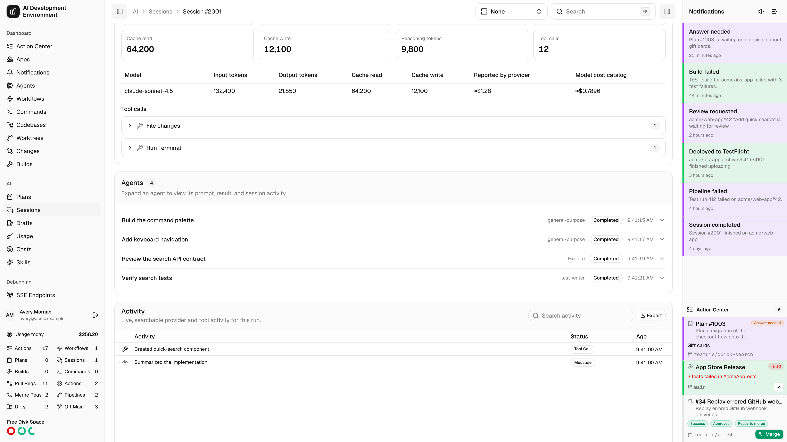
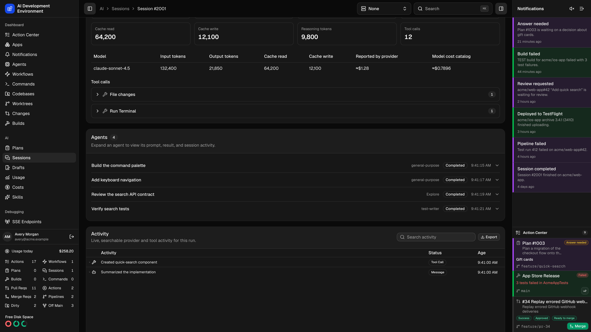
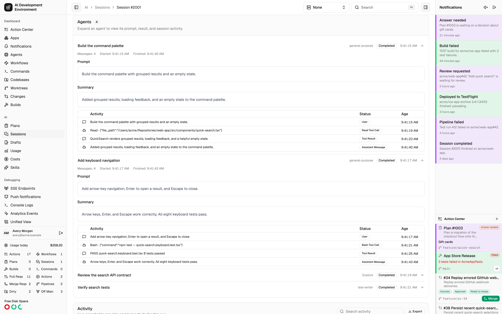
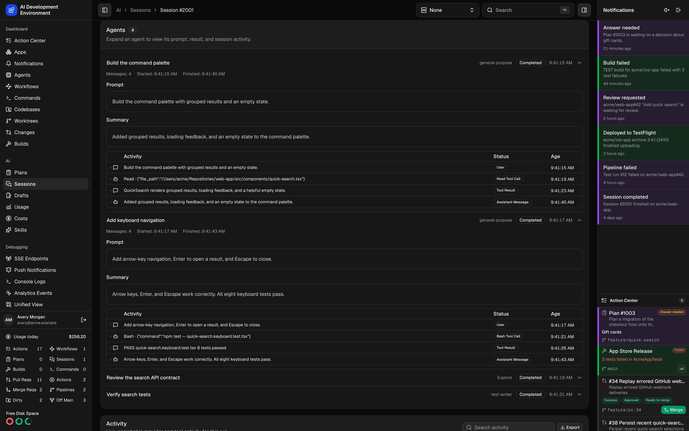
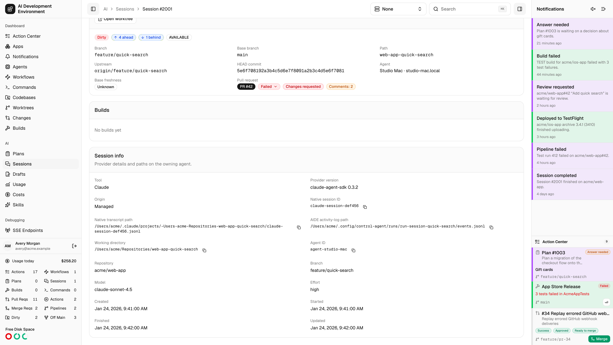
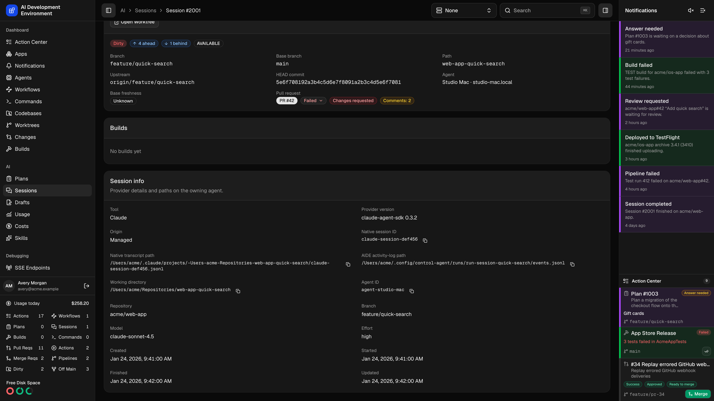

<Frame>
  
  
</Frame>

The Session details page at `/ai/sessions/{id}` is the live view of an implementation run: what it is doing right now, what it has changed in the worktree, what it has spent, and where to intervene. It is the same page as [Plan details](/ai/plan-detail) — this page focuses on the parts that matter when a run is writing code.

## Header and lifecycle

The header shows the Session number, status, phase, the AI tool, an **Imported** badge where relevant, and the repository, branch, and creation time.

A managed Session may begin as **Queued** with the phase **Waiting for worktree**. It starts automatically when its worktree's Session lane has capacity. You can cancel it before it starts.

| Action | Available when |
| --- | --- |
| **Pause** | Managed, in progress, and the tool supports pausing |
| **Continue** | Managed and paused |
| **Cancel** | Managed and not yet terminal |
| **Archive** / **Restore** | Always |
| **Delete** | Only when the tool supports deleting its own native history |

A failed run surfaces its error at the top of the page. So does a phase like *Start failed*, *Steer failed*, *Cancel failed*, or *Provider delete failed* — the status alone will not tell you which step gave up.

<Warning>
  **Imported worktree conflict** means this externally managed Session is active in a worktree currently leased by a managed Session. The app cannot apply concurrency control to a run it did not start, so the two are writing to the same checkout.
</Warning>

## Watching a run

<AccordionGroup>
  <Accordion title="Activity" icon="activity">
    The transcript streams over a subscription into a scrolling pane that stays pinned to the newest event unless you scroll away from the bottom. The pane opens with the newest 200 events; **Load more** adds older events in pages of 200. The search box re-queries the server rather than filtering what has already loaded.

    Related events collapse into a single expandable node — a tool call together with its result, a streamed message with its parts. Expanding a row shows the parsed detail, with the untouched payload available behind a raw toggle and a copy button.

    Codex rows distinguish **Commentary** from **Final Answer**, summarize completed commands and file changes, and collapse repeated token updates and identical diff snapshots.
  </Accordion>
  <Accordion title="Usage and estimated cost" icon="coins">
    Tiles for **Reported by provider**, **Model cost catalog**, input, output, cache read, cache write, and reasoning tokens, and the tool-call count. A per-model table breaks the same numbers down, and where an answer revision has retired earlier work a second table separates **Active attempts** from **Superseded** usage. Individual tool calls expand to their input, output, and error JSON.
  </Accordion>
  <Accordion title="Changes" icon="file-diff">
    The main diff compares the captured baseline with the file contents in the latest **Final** checkpoint. Each changed file appears once, whether its edits are staged, unstaged, or partially staged. An empty latest **Final** shows **No file content changes.** instead of falling back to an earlier patch.

    Checkpoint history stays collapsed by default. Expand **Start**, **Question**, **Answer rollback**, **Before answer revision**, **Continue**, or **Final** to inspect its HEAD SHA, branch, and patch or diff summary. Before a **Final** exists, changes appear only in this history.

    Patches list one collapsible row per file, with its change type and added and removed line counts; expand a row for the diff itself.
  </Accordion>
  <Accordion title="Summary" icon="file-text">
    The run's final output, shown once it reaches a terminal status. On a Plan the same card holds the proposal and is titled **Plan**.
  </Accordion>
  <Accordion title="Linked items" icon="git-fork">
    The source Plan, parent run, and any follow-ups, each with its status. A deleted relation is still shown, dashed and marked **Deleted**.
  </Accordion>
</AccordionGroup>

## Agent sessions

For a Claude run with discovered child agents, the **Agents** card appears above **Activity** in the web app. This card lists Claude's delegated tasks; the [Agents](/agents/agents) page manages the machines that run them.

<Frame>
  
  
</Frame>

Each compact row shows the task name, agent type when known, status, and start time. A nested agent also shows **Spawned by** with its parent. Status can be **Running**, **Completed**, **Failed**, **Cancelled**, or **Unknown**.

Expand a row to read its **Prompt**, **Summary** when available, and its own session activity. You can keep several agents open to compare their work. Activity entries expand into parsed details, with their payloads behind **Raw**.

Opening a row loads its newest 200 stored messages. **Load more** adds older messages without closing the other agents. Status and open transcripts refresh as the run changes. Searching the main **Activity** pane does not hide agents or filter their sessions.

### Use the native iOS app

Open the run's **Activity** tab to find the **Agents** section above the main activity timeline. Each disclosure row shows the task, type, status, start time, and parent when known. You can expand several agents at once.

An expanded agent shows its **Prompt**, **Final Output** when available, and messages. Expand a message to read its full text, then open **Message Data** to inspect the provider payload. **Load Older Messages** adds older history, and **Retry** reloads a failed read. Pull to refresh to update the agent list and open sessions; live run changes and returning to the foreground also refresh them.

### Older runs and missing transcripts

Updated control agents synchronize child sessions for both managed and imported Claude runs. Older runs can gain an **Agents** card after the owning agent next synchronizes, while the provider still retains their child history. The card stays hidden when no agents have been discovered.

| Situation | What you can read |
| --- | --- |
| Owning agent is offline | Previously synchronized agent details and messages remain available from the control plane. New progress waits for the agent to reconnect. |
| Partial transcript | Saved messages remain visible, with a notice that only part of the session is available. Collection errors or history limits can leave a partial transcript. |
| Unavailable transcript | The card keeps the known task, prompt, status, and result and explains that the transcript is unavailable. |
| Read fails | **Try again** retries loading the saved details or messages. Background synchronization supplies newly available provider history. |

<Note>
  Child prompts, results, tool inputs and outputs, and raw message payloads are stored with run history on the control plane. Apply the same access and backup policies as for the parent Session. Reading these saved sessions does not require downloading native transcript files from the agent.
</Note>

## Recovering from a control-plane outage

A temporary HTTP or WebSocket failure does not turn a completed provider run into a failed run. While the agent remains running, it keeps the provider result and retries reporting its final checkpoint, attempt result, and command completion after transient failures. Permanent request failures and agent shutdown stop those retries. The displayed status can lag until the control plane accepts completion.

Transcript events are journaled on the agent and uploaded incrementally from the last acknowledged position. After a restart, journal recovery preserves complete events and discards an incomplete final line before appending new output. Imported native history synchronizes in the background so it does not delay command recovery or the agent's notification connection.

On updated agents, a managed Session and an iOS build cannot execute against the same source worktree at the same time. The Session holds this source protection through provider startup, execution, final checkpoints, and process cleanup. A completed, cancelled, or failed status does not by itself prove that interrupted provider processes have stopped. Recovery retains protection and retries cleanup until it can verify that they have exited; check the agent's cleanup error if a build continues waiting. This protection is separate from the Session lane's concurrency limit.

## Intervening

<Steps>
  <Step title="Steer" icon="send">
    While a managed Session is in progress and its tool supports steering, the **Steer** card sends extra guidance — with attachments — into the active turn. Guidance queues behind any pending question rather than jumping ahead of it.
  </Step>
  <Step title="Answer questions" icon="circle-question-mark">
    A question batch appears inline as **Answer needed**. OpenCode 2 forms support typed text, number, integer, boolean, multiselect, and external-step controls, with defaults, validation, and conditional visibility. Complete external steps and acknowledge them separately from opening their links. **Cancel form** cancels the native request without cancelling the Session. Rejected submissions remain editable with the delivery error. These controls are available in web and iOS run details; see [native forms](/reference/opencode#answer-native-forms). Other questions retain their existing choice and free-text controls. Submitting resumes the run. A Session waiting for an answer keeps its worktree admission slot.
  </Step>
  <Step title="Revise an answer" icon="rotate-ccw">
    An answered batch that still has its checkpoint can be revised. The dialog prepares a rollback patch against the checkpoint taken immediately before the question, shows exactly what will be undone, and offers to stash the current tracked and untracked changes first. Its separate working-tree and index sections show the contents and staging state that rollback restores. Confirming starts a new linked Session from the revised answer and keeps the previous one as audit history.
  </Step>
  <Step title="Pause or cancel" icon="circle-stop">
    Pausing holds the run and its admission slot. Cancelling ends it and releases the slot, leaving the worktree in whatever state the run reached.
  </Step>
</Steps>

<Note>
  Turning off **Undo worktree changes made after this question** during a revision keeps the current worktree contents and changes only the answer. If commits from the rolled-back range have already been pushed, the dialog says so before you continue.
</Note>

## Follow-ups

| Mode | What the new run receives |
| --- | --- |
| **Resume** | The prior conversation, continued. Offered only when the tool supports resuming |
| **Fresh** | No prior context — just your new prompt |
| **Resend** | The original prompt again, editable, without prior context |

Switching tools on a resumed follow-up asks how to carry context across, since hidden provider state cannot transfer: **Visible transcript** sends the normalized conversation, **Final summary only** sends just the output.

<Warning>
  Starting a resumed follow-up from a paused Session cancels the parent and atomically transfers its worktree admission slot to the child. The page asks you to confirm — the parent will not survive it.
</Warning>

## Worktree controls

Immediately below **Follow Up**, three cards bring the linked worktree into the Session without making you leave the run:

| Card | What it contains |
| --- | --- |
| **Actions** | **Build**, **New Plan**, **New Session**, plus the command and workflow quick actions eligible for this worktree |
| **Worktree Status** | Clean or dirty state, origin sync, current and base branches, path, upstream, HEAD, agent, availability, base freshness, and pull request, review, and pipeline status |
| **Builds** | The latest 50 builds for the worktree, with **Load more**, build navigation, rebuild, and device run controls |

In the web app, select the review badge in **Worktree Status** to open [review details](/worktrees/worktrees#review-details), including approvers, requested reviewers, and code-owner rules.

**Open Worktree** opens the complete [worktree details](/worktrees/worktree-detail) page. Build and worktree changes refresh these cards in place. If supplementary worktree data cannot load, the Session itself remains usable and the card shows a retryable warning. Imported runs without a resolvable worktree omit the cards.

The run controls use the same agent-aware device picker as Builds and Worktrees: the build agent is the default, selecting another eligible Mac clears the current devices and loads that agent's destinations, and a remote run transfers the app without requiring the Session worktree on the target. The iOS app presents the same order and actions with native sheets. Its Follow Up form also supports attachments, eligible MCP presets, provider defaults, cross-provider context, and paused-Session transfer confirmation, then opens the created child run.

## Session info

The **Session info** card sits at the bottom of the detail page in the web and iOS apps, including runs with no Git checkpoints.

<Frame>
  
  
</Frame>

| Details | What they show |
| --- | --- |
| Provider and run | AI tool, provider version, managed or imported origin, repository, branch, model, and effort |
| IDs | The native session ID and the owning agent ID |
| Paths | Native transcript path, AIDE activity-log path, and recorded working directory on the agent |
| Timestamps | Created, started, finished, and updated times |

Select **Copy** beside an ID or an available path to copy its exact value. Native session information comes from the latest non-superseded attempt; a newer attempt with missing metadata does not reuse an older attempt's ID or paths.

| Provider | Native transcript path |
| --- | --- |
| Codex | The actual session JSONL file, including archived sessions and custom Codex home directories |
| Claude | The actual session JSONL file, including custom Claude configuration directories |
| OpenCode | No standalone session file is exposed; the card explains this instead of displaying a guessed path |

Managed runs can also show their AIDE activity journal. Imported runs have no AIDE activity log. Missing details are marked unavailable; older runs may gain supported metadata after the agent next synchronizes.

<Note>
  Locations are saved with the run and can reveal usernames and directory names. This card reports paths on the owning agent; it does not download the files or change their retention. Use **Export** when you need transcript contents.
</Note>

## Exporting

**Export** in the activity header offers **JSON** and **Markdown** of the complete unfiltered history, including superseded events. Claude, Codex, and OpenCode runs add an export of the tool's own JSONL transcript, and Claude and Codex runs still attached to an agent can download the original session file from disk verbatim.

## Notes

- Deleting a Session asks the AI tool to delete its native history first, then removes the local record. This cannot be undone; archive instead if you may want it back.
- The panel under the header lists workflows that can act on this Session, and any workflow runs already attached to it.

## Related pages

<Columns cols={2}>
  <Card title="Sessions" icon="terminal" href="/ai/sessions">
    The list this page opens from.
  </Card>
  <Card title="Plan details" icon="clipboard-list" href="/ai/plan-detail">
    The same page for a read-only Plan.
  </Card>
  <Card title="Worktree details" icon="git-branch" href="/worktrees/worktree-detail">
    The checkout this Session queued against and modifies.
  </Card>
  <Card title="Costs" icon="coins" href="/ai/costs">
    The price catalog behind the catalog-cost figure.
  </Card>
</Columns>
