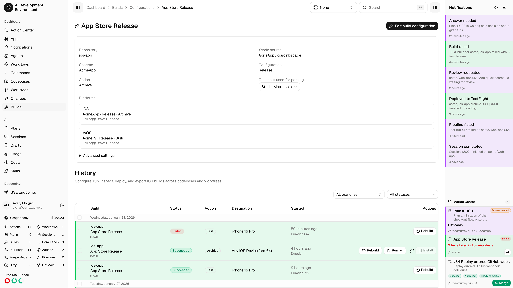
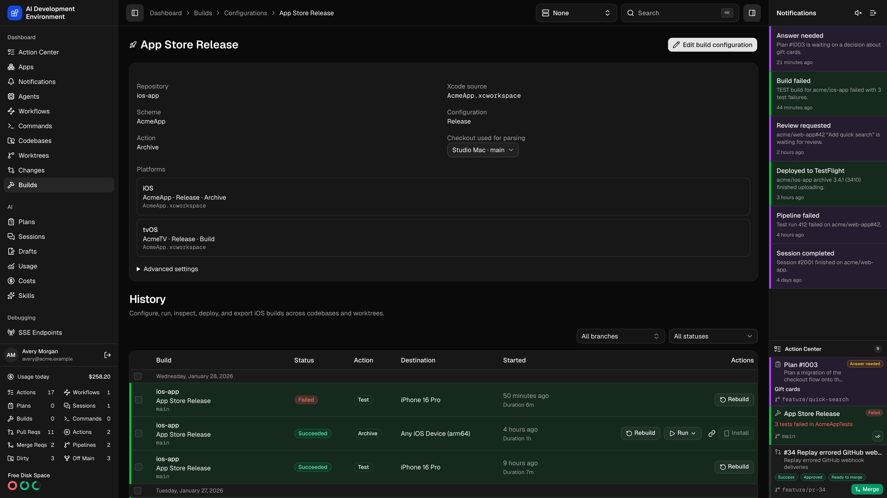
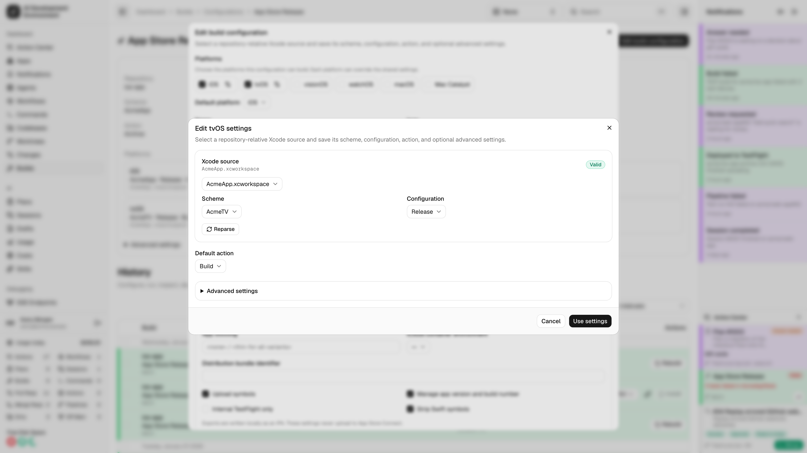
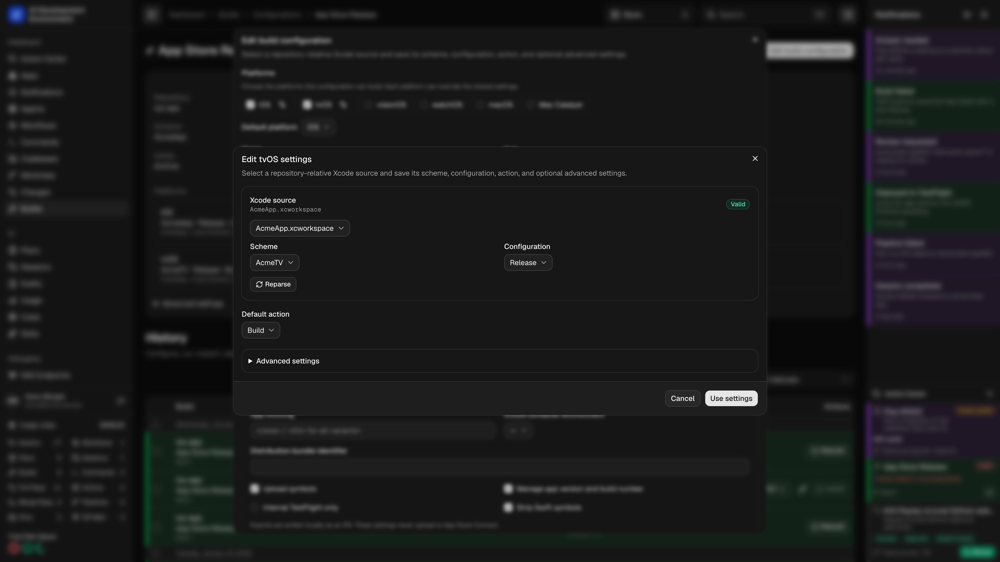

<Frame>
  
  
</Frame>

Open a saved configuration from **Builds → Configurations**, or select its name on a build row or detail page. The route is `/dashboard/builds/configurations/[configurationId]`.

Use the **Configurations** breadcrumb to return to the configuration list.

## Inspect and edit

The page shows the configuration's icon, repository, and shared Xcode settings. Expand **Advanced settings** to inspect build and export options. In the editor, use **Platforms** to add entries and **Default platform** to choose which one is selected first when you start a build.

Each platform can use the shared settings or specify its own source, scheme, Xcode configuration, action, advanced settings, signing, and archive export. For a separate watchOS target, choose its scheme in the watchOS entry. iPhone and iPad use the iOS entry, with the device chosen in **Start Build**.

<Frame>
  
  
</Frame>

Select an available checkout for parsing, then choose **Edit build configuration**. Source and destination discovery use Xcode on that checkout’s agent. A green **Valid** badge means the selected source, scheme, and Xcode configuration are available in that checkout. Saving updates future builds; existing build snapshots keep their captured settings.

The native app offers **Configurations** on Builds, with configuration details and an **Edit** action. Repository settings also provide an **Apple app project** screen for creating and removing configurations.

## Build history

History is filtered to this saved configuration across its repository's worktrees and agents. Older records load in pages. Open a build to inspect its logs and artifacts.

A build retains the configuration name captured when it started. If the saved configuration is deleted, that name remains visible without a link. **Custom** identifies an explicitly requested one-time configuration; it does not identify an imported coverage record or a deleted saved configuration.

## Custom builds

Select **Custom** in Start Build to enter platform and build settings for one submission. This creates no saved configuration or configuration-details page. Rebuilding a Custom build uses the settings captured in its snapshot, subject to current repository, agent, destination, and script validation.

## Related pages

<Columns cols={2}>
  <Card title="Builds" icon="hammer" href="/builds/builds">Start saved or Custom builds and manage scripts.</Card>
  <Card title="Repository details" icon="code-fork" href="/codebases/repository-detail">Manage the repository's iOS App project.</Card>
</Columns>
