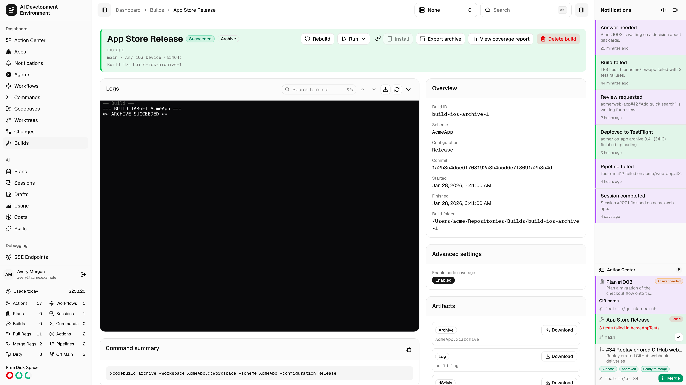
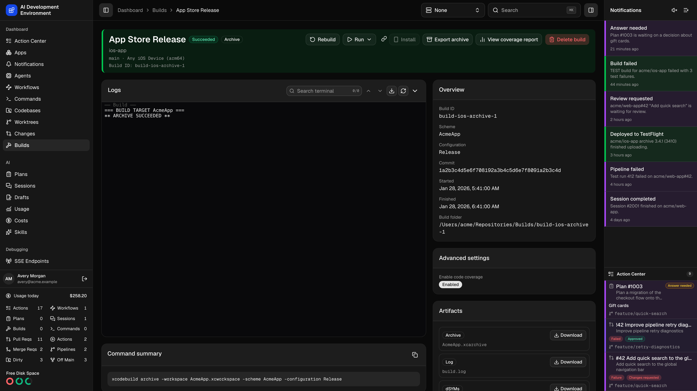
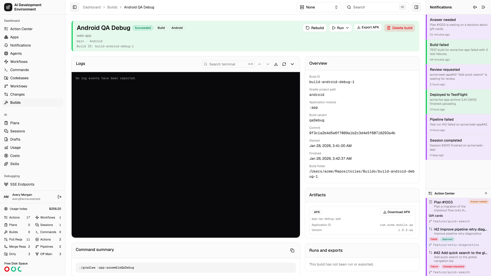
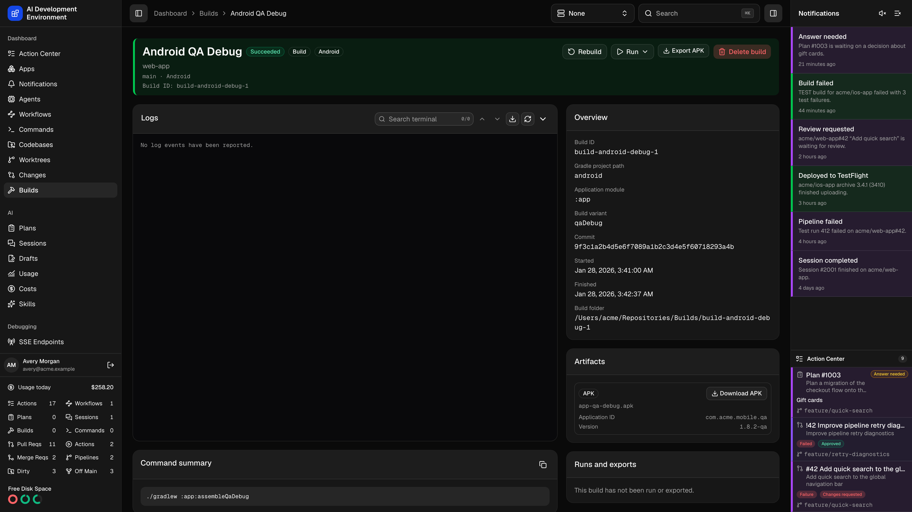
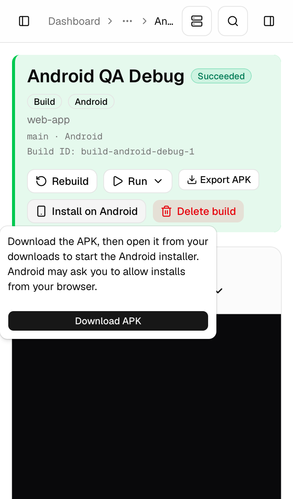
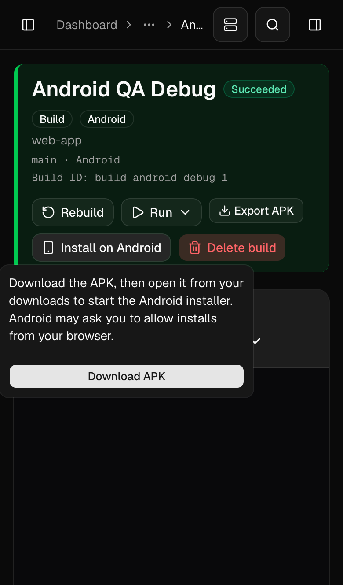
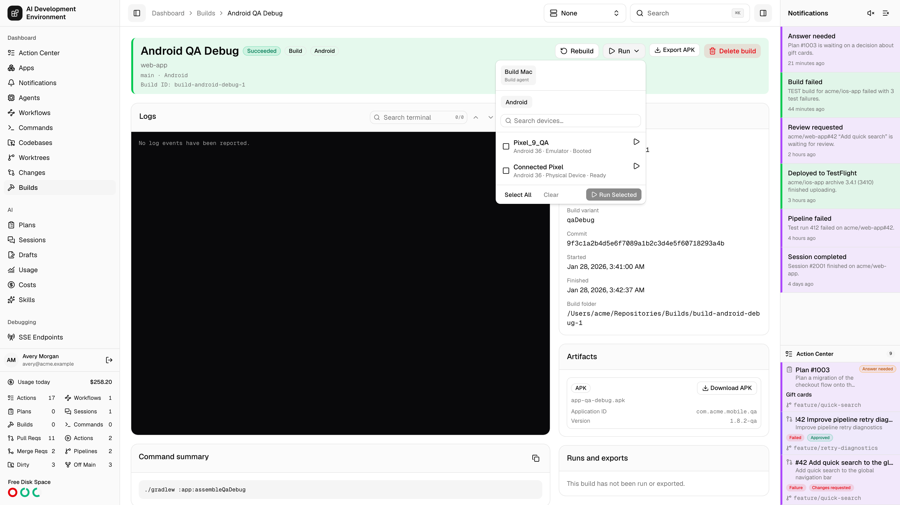
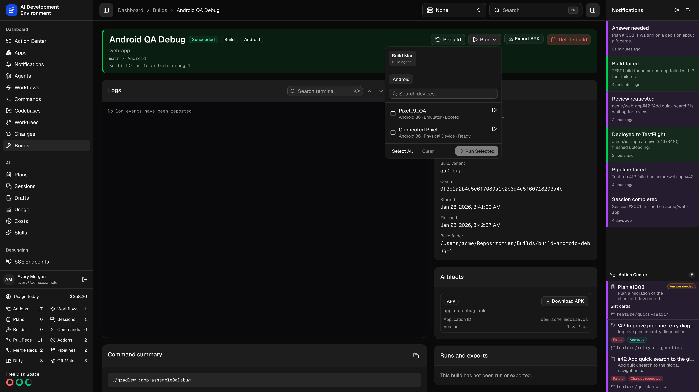

<Frame>
  
  
</Frame>

The build details page at `/dashboard/builds/{id}` covers one immutable build from end to end: what was run, what it printed, what it produced, whether the tests passed, and how to get it onto a device.

## Header actions

| Action             | Available when                                                              |
| ------------------ | --------------------------------------------------------------------------- |
| **Cancel build**   | The build is queued, preparing, or running                                  |
| **Rebuild**        | Always — starts a fresh build for the captured platform                   |
| **Run**            | The build produced a runnable app and a compatible destination is connected |
| **Install**        | An eligible IPA is available on iPhone or iPad                              |
| **Install on Android** | A signed APK is available in an Android browser                         |
| **Export archive** | The build captured an `.xcarchive`                                          |
| **Export APK**     | The Android build produced an APK                                           |
| **Delete build**   | Always                                                                      |

An **Out of date** badge appears when the worktree has moved on since this build was made. Select it for a **Rebuild** menu; the current surface refreshes and shows any queuing error. The header shows **Custom** or the captured configuration name, with a link when the saved configuration still exists.

**Rebuild** stays on this build. After the replacement is queued, an inline success notice offers an explicit link to the new build. **Run** uses the shared detailed device picker: checkbox multi-selection, per-device quick play, platform and OS details, live availability, **Select All**, **Clear**, and **Run Selected**.

After a run is accepted, the web and iOS apps continue watching its installation and launch result. A later failure remains visible on Build Details even after the picker closes; open **Runs and exports** for the destination and full error. A successful queue response alone does not mean the app launched.

The picker starts on the build agent. Mac and Mac Catalyst builds launch there. For other artifacts, the picker can switch to another eligible Mac to run on one of its compatible simulators or devices. Cross-agent deployments show their target agent and transfer state in **Runs and exports**. While the app package moves through the relay, Build Details reports upload/download progress; checksum, compatibility, disk-space, extraction, signing, installation, and launch failures remain attached to that deployment with an actionable message.

## Overview

The platform, scheme, action, destination, commit, build ID, start and finish times, duration, and the build folder path on the agent.

While a build is **Queued**, the web page shows its resource-blocking reason when one is available, such as an active build, AI Session, worktree move, or pending merge confirmation. It starts automatically when the conflicting operation releases its protection. GraphQL clients can read the same message from `Build.blockedReason`.

A process cleanup warning can appear alongside an otherwise completed build. The agent keeps the original outcome and captured artifacts while retrying cleanup verification; conflicting work remains protected until verification succeeds. See [Process cleanup warnings](/builds/builds#process-cleanup-warnings).

The **Command summary** shows the exact `xcodebuild` invocation, with **Copy command summary** to reproduce it by hand. Advanced settings captured at build time are listed too; older builds may report that advanced settings were not captured.

An **Install** button appears immediately after **Run** when the build contains an IPA. It uses the newest eligible IPA and keeps the same HTTPS, export-method, and metadata checks as artifact installation. On unsupported browser devices, select the disabled-looking button for “Open this page on an iPhone or iPad to install.” Copied installation links always open this build's page.

## Logs

Logs open at the newest page and follow new output while you remain at the bottom. Scroll upward to fetch preceding pages. Earlier chunks are inserted in chronological order while preserving your reading position; duplicate and late chunks are reconciled in place. Loading and retry feedback appears above the terminal. Return to the bottom or select **Follow output** to resume tailing. The native app loads log history separately from build-detail refreshes.

Live streaming output with the same terminal controls used elsewhere in the app:

- **Follow output** pins the view to the newest line.
- **Search terminal** with previous and next match navigation.
- **Fit terminal**, **View raw output**, and scroll to top or bottom.
- **Expand logs** / **Collapse logs** for a full-height view.

Hook output appears in the combined build log, tagged with its pre-build or post-build phase. See [Script executions](#script-executions) for individual hook outcomes.

## Script executions

The **Scripts** section lists the captured script name, phase, status, and any error for each hook. If no scripts were selected, it shows an empty state. Statuses use colored badges for success, failure, running, pending, cancelled, and skipped states. The native Build Details screen also lists script execution outcomes with colored status pills.

| Status | Meaning |
| --- | --- |
| `PENDING` | The hook was captured when the build was queued; it has no completed execution result |
| `SUCCEEDED` | The hook completed successfully |
| `FAILED` | The hook threw an error or exited unsuccessfully |
| `TIMED_OUT` | The hook exceeded its configured timeout |
| `CANCELLED` | The hook was interrupted by cancellation |

A skipped pre-build hook can remain `PENDING` because no execution result was produced. Post-build hooks still run after Xcode preflight failures, pre-build failures, and cancellation once the agent reaches the build's cleanup phase.

GraphQL `Build.scriptExecutions` also exposes `position`, `nameSnapshot`, `sourceSnapshot`, `timeoutSeconds`, `failureBehavior`, `exitCode`, `durationMs`, `causedBuildFailure`, `outputRelativePath`, and `error`. A failed hook does not necessarily mean a failed build: **Continue with a warning** records the failure while allowing execution to proceed. See [Build script execution and failures](/builds/builds#execution-and-failures) for ordering, timeout, and cancellation rules.

## Artifacts

Everything the build captured — the archive, the runnable app, test products, the `xctestrun`, the result bundle, and the dSYMs — each with a **Download**. Choose a shared Local, Remote, or configured Proxy address before downloading. The server produces a signed link for that address, so a different hostname does not require your browser cookie. Download links expire after six hours; treat a shared signed link as access to the artifact. The native artifact link sheet offers copy, share, and download actions.

When the build kept its dSYMs, a **dSYMs** artifact holds them as `dSYMs.zip` with the number of bundles, and **View dSYMs** opens the [dSYMs](/debugging/dsyms) table filtered to this build. After a successful build the control plane imports that zip automatically, so crashes from this build can be symbolicated. **Collect dSYMs** in the advanced settings decides whether a build keeps them; archives do by default.

## Test results

**Parse test results** reads the result bundle and produces a test report. If parsing fails, **Retry test parsing** runs it again.

Once parsed you get totals — tests, passed, failed, skipped — and a browsable tree grouped by suite and file, with per-suite pass rates. Filter to **All**, **Passed**, **Failed**, or **Skipped**. Tests without a suite or without a file are grouped separately.

## Coverage

**Generate coverage report** builds the coverage report for this build; **View coverage report** opens it. See [Build coverage report](/builds/build-coverage).

## Exporting an archive

**Export archive** exports the captured `.xcarchive` on the build agent. Device exports can produce an IPA. Mac and Mac Catalyst exports can produce an app or installer package.

<Steps>
  <Step title="Choose a distribution method" icon="box">
    Choose from the export methods available for the archive’s platform. Mac and Mac Catalyst support **Copy App**, **Developer ID**, and **App Store Connect**.
  </Step>
  <Step title="Select the team and signing" icon="shield">
    Pick a development team from those installed on the build agent, then a signing certificate — chosen automatically or named explicitly. **Parse project** reads the scheme's signable targets and matches installed provisioning profiles, giving you one profile selector per app and extension.

    Toggle between **Show matching** and **Show all** profiles, and add a bundle identifier by hand if parsing missed one. Expired profiles and profiles that may not match a bundle are flagged.

  </Step>
  <Step title="Set export options" icon="sliders">
    Upload symbols, manage app version and build number, internal TestFlight only, strip Swift symbols, app thinning, iCloud container environment, and a distribution bundle identifier — as applicable to the chosen method.
  </Step>
</Steps>

<Note>
  The agent writes exports locally, including exports prepared for App Store Connect.
</Note>

<Warning>
  When a signing identity is installed on only some of your signing-capable
  agents, the page warns you — builds assigned to a machine without it will fail
  to export.
</Warning>

## Installing over the air

**Install** serves the exported IPA for direct installation. Choose Local, Remote, or configured Proxy using the address picker; **Copy install link** includes that choice in the build page URL. The OTA manifest resolves `serverUrlKind` against shared settings and signs the package URL at the same address. The page reports the bundle identifier and version being installed.

Requirements and limits:

| Condition                 | Result                                                                                                    |
| ------------------------- | --------------------------------------------------------------------------------------------------------- |
| No public HTTPS address   | Installation is blocked — choose a reachable HTTPS address in [Server URLs](/system/settings#server-urls) |
| Opened on a Mac           | You are told to open the page on an iPhone or iPad                                                        |
| App Store Connect export  | Cannot be installed over the air — export with Debugging, Release Testing, or Enterprise instead          |
| Missing bundle identifier | Export the archive again to enable installation                                                           |

## Runs and exports

A record of every time this build has been run on a device or exported, so a single build's distribution history stays in one place. Device deployments identify the target agent as well as the destination, which prevents identical simulator or device identifiers on different Macs from being conflated.

## Install or export an Android APK

<Frame>
  
  
</Frame>

- **Run** queues installation and launch on an emulator or an authorized physical device. On the web, reopening **Run** refreshes the agent and destination lists. The picker keeps your selected agent while it is eligible. Otherwise, it chooses the build agent if eligible or another available agent. In the iOS app, if the build agent lacks Android SDK Platform Tools, the picker selects another agent when one is available. Inspect the result under **Runs and exports** if installation or launch fails.
- On an Android phone, choose **Install on Android**, then **Download APK**. Open the download and follow Android's package installer. Android may ask you to allow installation from your browser or file manager, and your device's policy may restrict the install.
- **Export APK** downloads the same package for later use. In the iOS app, open **Export APK** to share the download link or prepare the APK file and share it through the system share sheet.

<Frame caption="Open the build in an Android browser to use Install on Android.">
  
  
</Frame>

Anyone who can reach the server with a shared signed URL can download the APK until the URL expires. Use a fresh link after expiry. For an in-place update, the installed app and the APK must use a compatible signing key.

Install Android SDK Platform Tools on the run agent. To use an **Emulator**, also install Android Emulator and a compatible system image. The agent starts the selected emulator if needed. To use a **Physical Device**, enable debugging, connect the device to the agent over USB or Wi-Fi, and authorize the agent on the device.

<Frame>
  
  
</Frame>

[Android website distribution and installation](https://developer.android.com/distribute/marketing-tools/alternative-distribution) · [Android app signing](https://developer.android.com/studio/publish/app-signing)

## Related pages

<Columns cols={2}>
  <Card title="Builds" icon="hammer" href="/builds/builds">
    Build history and the reusable build script library.
  </Card>
  <Card title="Devices" icon="mobile" href="/system/devices">
    Enrolled iPhones and iPads that builds can be installed on.
  </Card>
</Columns>
