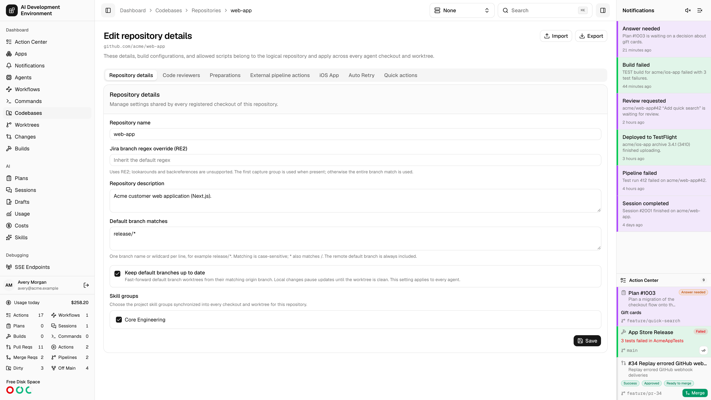
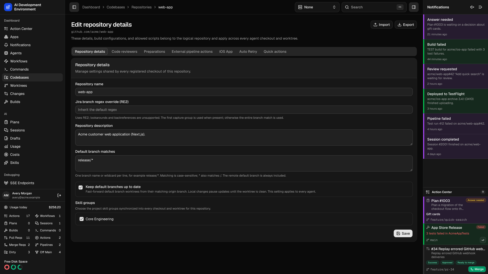
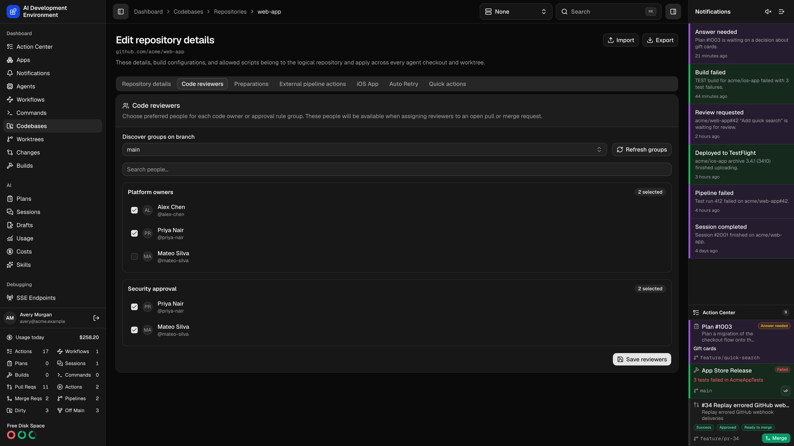
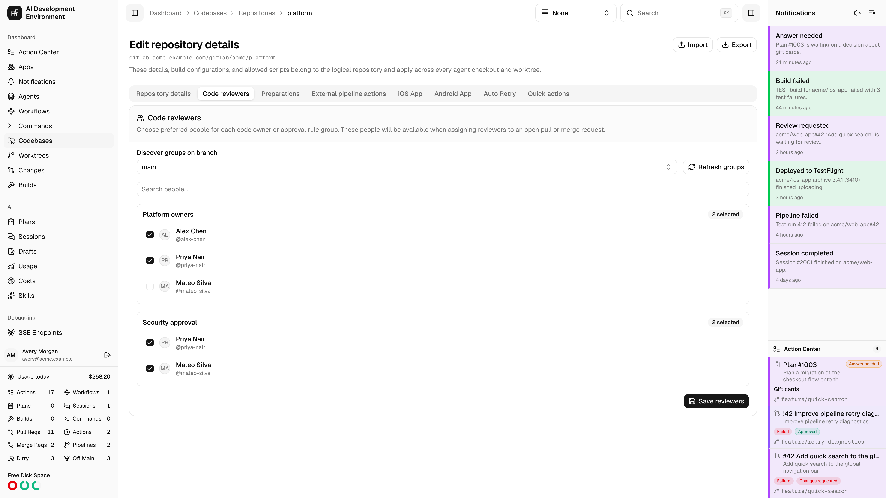
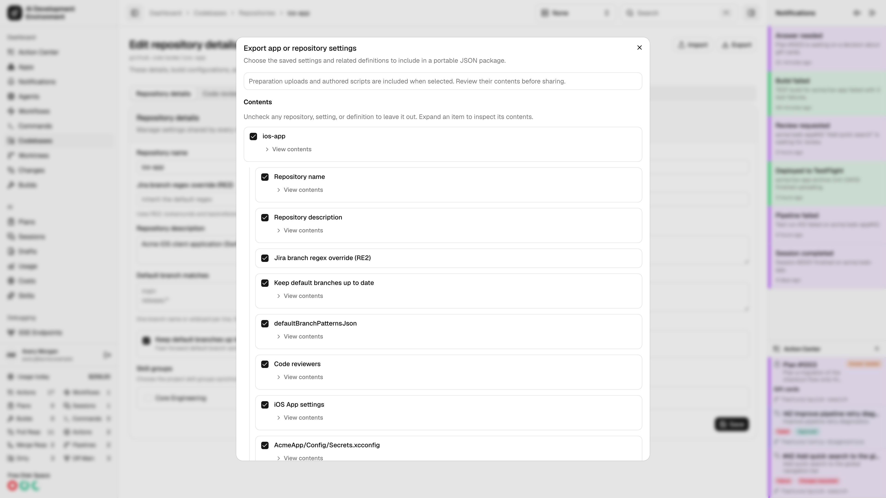
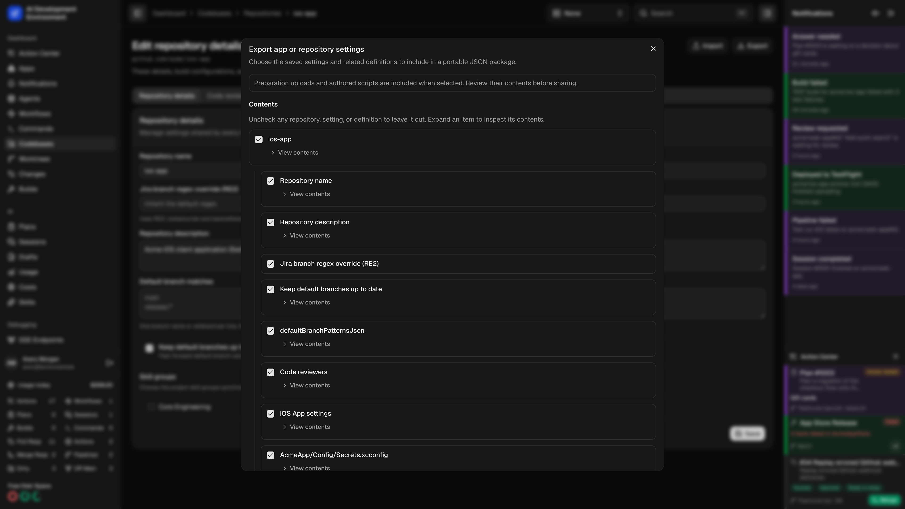
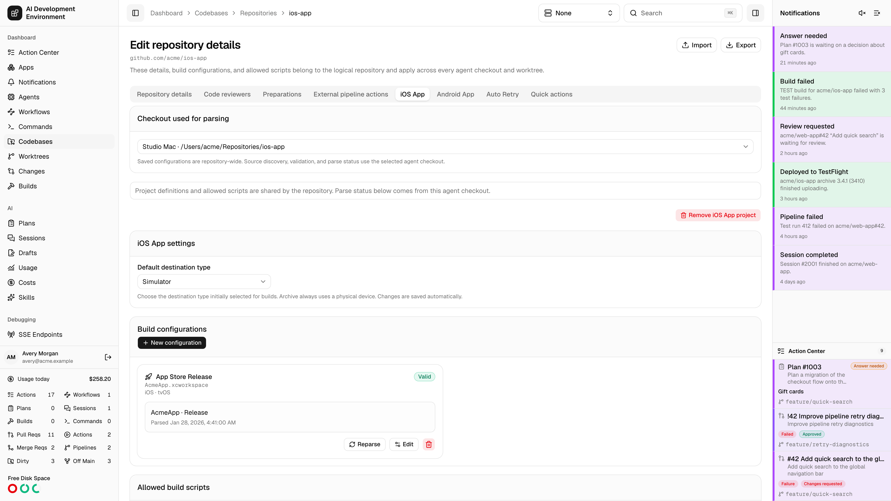
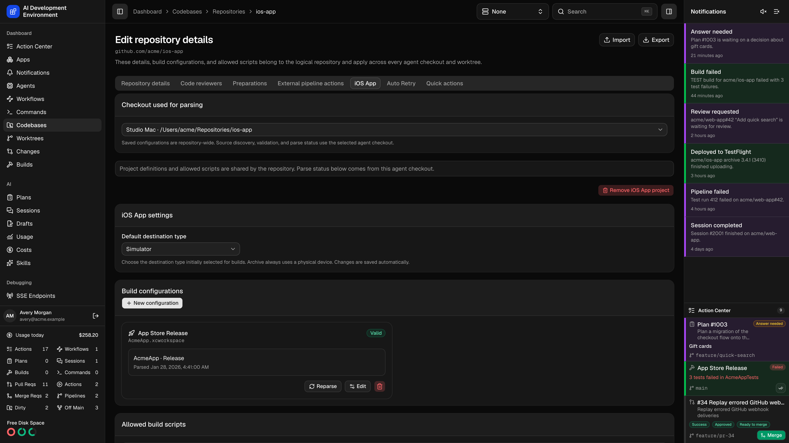

<Frame>
  
  
</Frame>

The repository details page at `/dashboard/codebases/repositories/{id}` manages settings that belong to the *logical* repository rather than to any one checkout. Everything here applies across every agent checkout and every worktree that shares the origin.

The page has seven tabs.

<Tabs>
  <Tab title="Repository details">
    | Setting | Notes |
    | --- | --- |
    | **Repository name** | The shared name used everywhere this repository appears |
    | **Repository description** | Optional context |
    | **Jira branch regex override** | Extracts a ticket key from a branch name for this repository. Leave empty to inherit the default from [Codebases settings](/codebases/codebases). The first capture group is used when present, otherwise the whole match. |
    | **Default branch matches** | Add exact names such as `develop` and wildcard patterns such as `release/*`, one per line. Matches are case-sensitive and cover the full branch name; `*` matches any characters, including `/`. Other characters are literal. The remote default branch is always included. An empty list adds no extra default branches. |
    | **Keep default branches up to date** | After fetches, fast-forward clean matching worktrees from their same-named branch on `origin`. Dirty worktrees pause automatically and resume when clean. Local ahead or diverged histories are preserved. Applies on every agent. |
    | **Skill groups** | The project skill groups synchronized into every checkout and worktree of this repository. |

    Automatic default-branch maintenance requires an updated agent. Older agents continue fetching but do not perform this maintenance.

    In iOS, open **Edit Repository** to change the same patterns and update setting. Existing **Keep base branch up to date** values are retained under the new label. A worktree stops these automatic updates as soon as its checked-out branch no longer qualifies. Changing its comparison base does not change which remote branch supplies updates.

    <Tip>
      Skill groups are how a repository gets a consistent set of agent skills on every machine. Define them under [Skills](/skills/skill-groups), then assign them here once instead of per checkout.
    </Tip>
  </Tab>
  <Tab title="Code reviewers">
    <Frame>
      
      
    </Frame>

    Choose the people you want to offer when assigning reviewers to GitHub pull requests and GitLab merge requests. Preferences apply to every checkout and worktree of this repository.

    Select **Discover groups on branch**, then choose preferred people under each discovered code owner, approval rule, or general reviewer group. Use **Search people** to narrow long lists. **Refresh groups** updates provider discovery while retaining your unsaved selections; **Save reviewers** stores the displayed pools. Preferences for other groups are retained.

    The request's target branch and changed files determine which rules apply when assigning reviewers. Discover another branch here when its ownership groups differ. The saved preferences narrow the provider's eligible candidates; they do not change its ownership or approval rules.

    Unverifiable saved people remain labeled with unavailable eligibility and can be removed. Discovery issues explain inaccessible teams, rules, or provider capabilities. Resolve those issues before relying on the list as complete.

    In iOS, open **Edit Repository → Code reviewers** to configure the same shared pools. See [Assign reviewers](/worktrees/worktrees#assign-reviewers) for manual and random selection.

    <Frame>
      
      
    </Frame>
  </Tab>
  <Tab title="Preparations">
    Upload files to write or override, list exact paths to delete, and select tracked paths that should always be assume-unchanged. Saving updates the repository definition without modifying existing worktrees.

    See [Repository preparations](/codebases/repository-preparations) for path rules, upload limits, Git behavior, and force-aware Sync and Rebase handling.
  </Tab>
  <Tab title="External pipeline actions">
    Enable repository JavaScript scripts for retrying and canceling external GitLab CI work. Add write-only named secrets using the configured credential backend. All checkouts share the scripts and secret names.

    In iOS, open **Edit Repository → External pipeline actions**. See [External pipeline actions](/gitlab/external-pipeline-actions) for the context contract, runtime limits, and provider recipes.
  </Tab>
  <Tab title="iOS App">
    Enables reusable Xcode build configurations for every checkout and worktree of this repository.

    <Steps>
      <Step title="Add the iOS App project" icon="mobile">
        **Add iOS App project** registers the repository as having an Xcode project. This alone enables Start Build, including **Custom** builds before any saved configuration exists.
      </Step>
      <Step title="Choose the default destination type" icon="mobile">
        Set **Default destination type** to **Physical Device** or **Simulator**. The default is **Simulator**. The web and native Start Build controls use this repository-wide preference when selecting a destination for a saved or Custom configuration. You can choose another type for an individual build. Archive always uses a physical-device destination; if the preferred type has no available destination, Start Build selects an available type instead.
      </Step>
      <Step title="Create build configurations" icon="sliders">
        A configuration selects a repository-relative Xcode source and saves its scheme, configuration, action, and optional advanced settings. Configurations are repository-wide and available from every worktree. **Collect dSYMs** under advanced settings keeps a build's dSYMs for [crash symbolication](/debugging/dsyms#collect-dsyms-from-builds): automatically for archives, always, or never.
      </Step>
      <Step title="Allow build scripts" icon="file-code">
        Reusable pre-build and post-build hooks are authored on the [Builds](/builds/builds) page. Allow specific scripts here or select this repository directly in the script editor. Script icons appear alongside their names.
      </Step>
    </Steps>

    <Note>
      Project definitions and allowed scripts are shared by the repository, but source discovery, validation, and parse status are computed from the agent checkout you have selected. A configuration can be valid on one Mac and unavailable on another if the checkout differs.
    </Note>
    A green **Valid** badge identifies successfully validated configuration settings. **Remove iOS App project** asks for confirmation, then removes the project, its configurations, sources, and observations together. Repository files, build history, artifacts, and script assignments remain. Any active build in this repository, including a Custom build, prevents removal until it finishes.

    In the native app, open **Edit Repository → iOS App project** to manage the project and configurations using native controls. Tap **Save** after changing **Default destination type**. The web selector saves the preference as soon as you choose it.
  </Tab>
  <Tab title="Auto Retry">
    Durable rules that automatically rerun GitHub Actions workflows or jobs.

    | Setting | Options |
    | --- | --- |
    | **Applies to** | Current runs, future runs, or both |
    | **Pipelines and jobs** | Specific workflows and jobs, or all workflows including ones added later |
    | **Retry mode** | Retry failures, or retry successful runs by count |
    | **When a failure occurs** | Retry failed jobs only, or retry all jobs |
    | **Retry limit** | 1 to 100, or unlimited |

    Saved rules show their progress as automatic retries across runs, and can be paused, resumed, edited, or deleted. Rule statuses are **Active**, **Paused**, **Completed**, **Exhausted**, and **Error**.

    <Warning>
      Auto Retry is available only for repositories hosted on GitHub, and requires a personal access token plus a verified GitHub App with Actions write access. See [Credentials](/system/credentials).
    </Warning>
  </Tab>
  <Tab title="Quick actions">
    The workflows this repository inherits as quick actions, each showing its action type — **Standard**, **Merge conflict**, or **GitHub Actions** — and its scope, either **All repositories** or limited to a specific count.

    Configured workflows stay listed while paused, marked **Paused**. The action itself only appears when the workflow is published, enabled, and matched to the current resource.

    <Note>
      This tab is a read-out of what applies here. To change a workflow's action type or repository scope, open the workflow on its own [details page](/workflows/workflow-detail).
    </Note>
  </Tab>
</Tabs>

## Why these settings are repository-wide

A repository is usually checked out on more than one Mac, and each checkout can carry several worktrees. Putting preparations, build configurations, skill groups, and retry rules on the repository means every checkout uses one definition instead of maintaining per-machine copies.

## Import and export settings

<Frame>
  
  
</Frame>

Use **Import** or **Export** in repository details to open the shared configuration review. Save pending repository details and preparation edits first; transfers use the saved definition.

Export can include the repository name, description, Jira regex, default-branch update setting and branch patterns, reviewer pools, preparations, iOS build configurations, repository commands, and workflows. Uncheck any item or individual repository setting you want to leave out. Imported reviewer pools are checked against the destination provider and current membership; unresolved groups or people block that selection. See [Reviewer preferences in packages](/apps/import-export#reviewer-preferences-in-packages).

Import applies selected settings to the repository you are editing. Its Git origin and existing checkouts stay in place. When an app package contains several repositories, choose **Repository to use as the template**. Additional clones are optional. The preview shows current and imported values, shared definitions affected elsewhere, and dependencies that need local mappings.

The native app offers this flow from **Edit Repository**. See [Import and export](/apps/import-export) for conflict resolution, dependency handling, and clone progress.

## Related pages

<Columns cols={2}>
  <Card title="Codebase details" icon="code-branch" href="/codebases/codebase-detail">
    Branch and stash management for a single checkout.
  </Card>
  <Card title="Builds" icon="hammer" href="/builds/builds">
    Build history and the reusable build scripts you allow here.
  </Card>
  <Card title="Repository preparations" icon="file-pen" href="/codebases/repository-preparations">
    Configure managed files for every worktree.
  </Card>
</Columns>

## iOS project management

<Frame>
  
  
</Frame>
