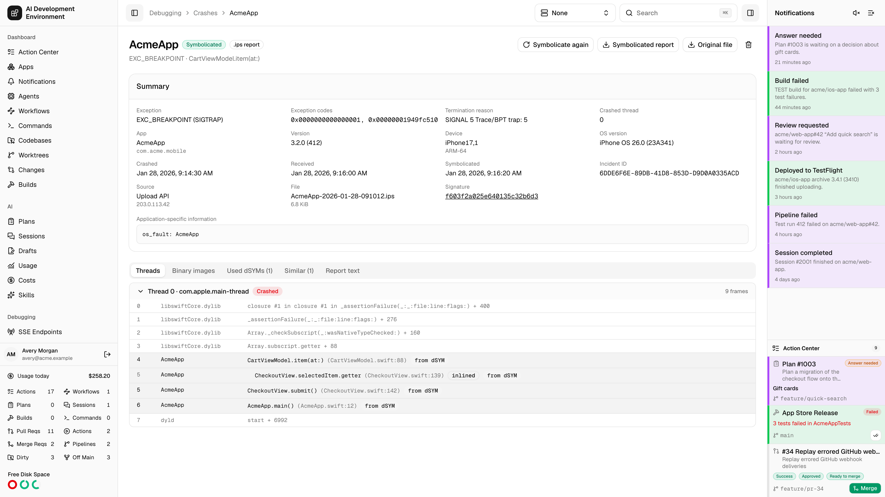
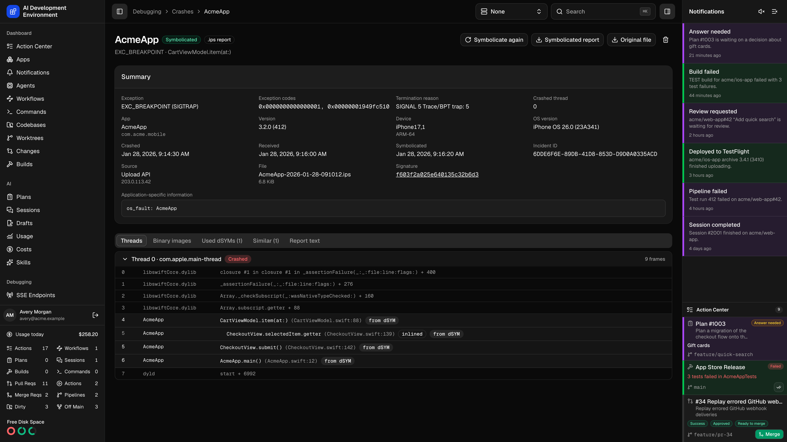
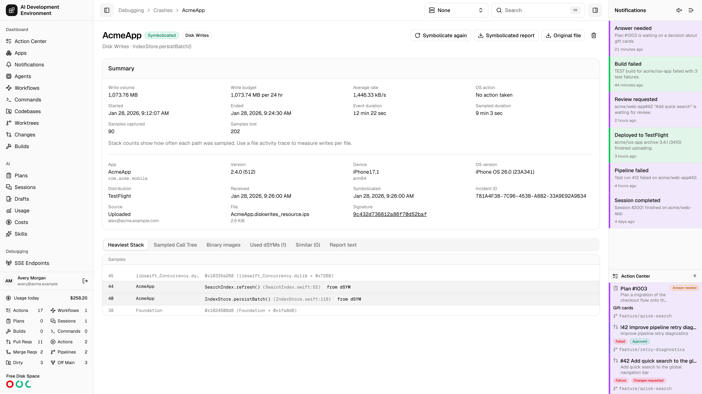
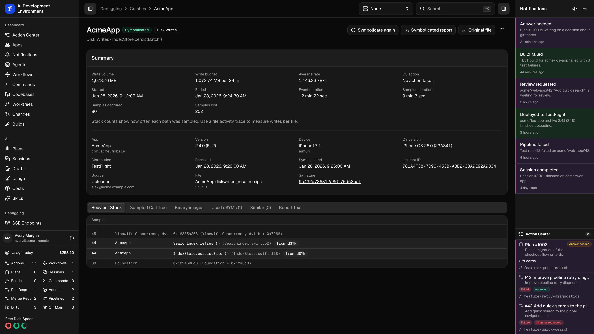

<Frame>
  
  
</Frame>

The crash details page at `/debugging/crashes/{id}` shows an iOS crash report or disk-write diagnostic with the symbols supplied by matched dSYMs. You can review both report types in the iOS app.

## Header actions

| Action | What it does |
| --- | --- |
| **Symbolicate again** | Discards the stored symbols and symbolicates from scratch with the dSYMs uploaded now. Available once the crash is not already being symbolicated |
| **Symbolicated report** | Downloads a text rendering of the report with the added symbols |
| **Original file** | Downloads the file exactly as it was uploaded |
| Delete | Deletes the report and, once no other crash from the same upload needs it, its file |

A MetricKit payload with several diagnostics is stored once and shared by the crash reports it produced.

## Missing dSYMs

When an app binary has frames without names and no uploaded dSYM matches its UUID, the page lists each such binary with its UUID and architecture. Click **Upload dSYMs** to add them from here. The crash is symbolicated again as soon as a matching dSYM arrives, with no further action.

<Tip>
  Compare the listed UUID with `xcrun dwarfdump --uuid MyApp.app.dSYM` to find the right dSYM. A mismatch usually means the crash came from a different build than the dSYM you have — for example a TestFlight build made on another machine.
</Tip>

## Summary

The summary card shows the exception type and signal, exception codes, termination reason, crashed thread, app and bundle ID, version and build, device model and OS version, when the app crashed and when the report arrived, when it was last symbolicated, the incident ID, and how the report reached the server — a signed-in user, an API key, or an anonymous address.

**Application-specific information** holds messages the process left behind, such as a Swift `fatalError` message or an uncaught Objective-C exception's reason.

The **Signature** links to every crash with the same signature.

## Threads

The crashed thread is first and expanded. Other threads are collapsed; click one to open it.

Each frame shows its number, binary, and function. App frames are highlighted. A frame a dSYM named is marked **from dSYM** and shows its source file and line. When the compiler inlined functions, `atos` reports each one: the inlined functions come first, marked **inlined**, followed by the function that contains them, all with the same frame number.

Frames in system libraries keep the names the device gave them.

## Disk-write diagnostics

<Frame>
  
  
</Frame>

iOS generates a disk-write diagnostic when an app exceeds a write budget. The summary shows the amount of file-backed memory dirtied, the write budget and its time window, the event duration and average rate, and any action the system took.

**Heaviest Stack** opens by default. Switch to **Sampled Call Tree** to expand other paths. Counts show how many samples include each frame at that position. The summary also shows the time covered by sampling and the number of lost samples when the device reports them. Use an Instruments File Activity trace to measure specific operations or files.

The **Similar** tab groups reports with the same app and sampled path. The dashboard offers the original export and a symbolicated text rendering.

## Other tabs

| Tab | Shows |
| --- | --- |
| **Exception backtrace** | The backtrace of an uncaught exception, when the report has one |
| **Binary images** | Every loaded binary with its UUID and load address. App binaries link to their dSYM or show **Missing** |
| **Used dSYMs** | The dSYMs that named this crash's frames |
| **Similar** | Other crashes with the same signature, newest first |
| **Report text** | The symbolicated report as text |

If a dSYM is deleted after it was used, the crash keeps its names and the binary image shows no dSYM link.

## Related pages

<Columns cols={2}>
  <Card title="Crashes" icon="bug" href="/debugging/crashes">
    All crash reports, uploads, and crash settings.
  </Card>
  <Card title="dSYMs" icon="file-zipper" href="/debugging/dsyms">
    Upload the dSYMs a crash is missing.
  </Card>
</Columns>
