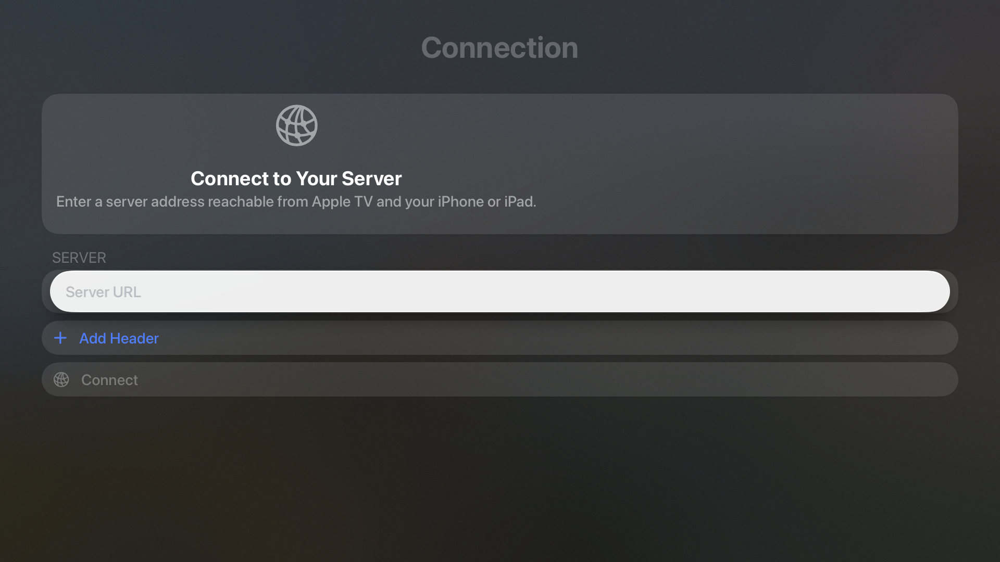
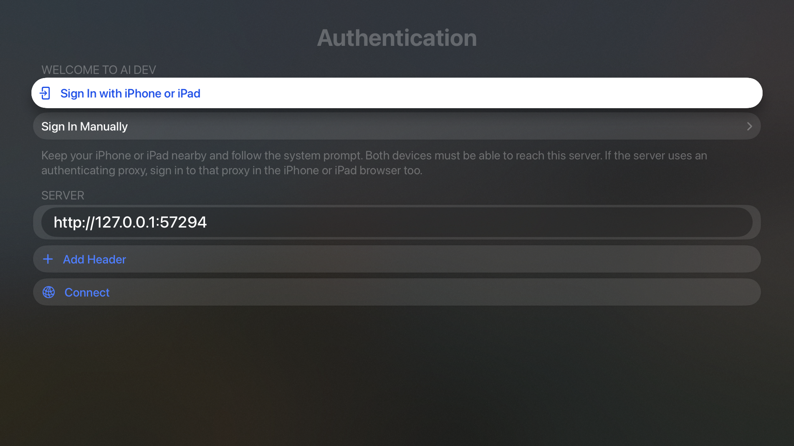
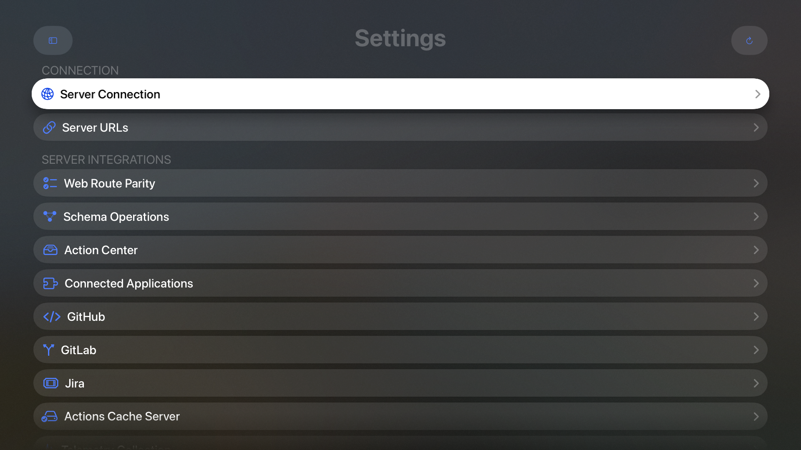

Use the native AI Development Environment app on iPhone, iPad, or Apple TV to manage your control plane. Apple TV supports tvOS 27.1 and later and includes server actions, live updates, and [simulator management](/system/simulators).

On iPhone or iPad, you can configure and start [Android builds](/builds/builds#start-an-android-build), run them on an Android destination connected to an agent, and export the APK for sharing. **System → Simulators** also offers [Android emulator management](/system/simulators#manage-android-emulators), and [Build Data](/system/build-data#gradle-build-data) shows managed Gradle project caches.

## Connect Apple TV

<Frame caption="Apple TV asks for your server address on first launch.">
  
</Frame>

1. Enter the control plane's URL in **Server URL**. Use a LAN hostname, LAN IP address, or HTTPS address that both Apple TV and your assisting iPhone or iPad can reach.
2. If an authenticating proxy requires headers on API requests, select **Add Header** and enter them on Apple TV.
3. Select **Connect** to load the server's authentication configuration.

A loopback address such as `127.0.0.1` or `localhost` refers to the device making the request. Use your server's actual reachable address when connecting separate devices.

Custom headers stay on the device where you configure them. The nearby sign-in browser does not receive Apple TV's API headers. If the server sits behind Cloudflare Access or another authenticating proxy, sign in to that proxy in the assisting device's browser as well.

## Sign in with iPhone or iPad

<Frame caption="Nearby sign-in on an Apple TV simulator. The loopback URL is a local test address; use an address reachable from both devices for nearby sign-in.">
  
</Frame>

1. Keep your iPhone or iPad nearby and choose **Sign In with iPhone or iPad** on Apple TV.
2. Follow Apple's system prompt on the assisting device.
3. Complete the server's web sign-in screen. It offers the configured password or OIDC methods and supports registration or first-account setup when allowed.
4. Return to Apple TV after sign-in completes.

If your browser is already signed in to the control plane, the flow can complete using that account. Apple TV receives a separate session. Signing out in the browser leaves the TV session active, and signing out on Apple TV leaves the browser session active.

Select **Sign In Manually** to enter a password on Apple TV when the server enables password authentication. If you cancel nearby sign-in, start it again from the authentication screen. If you change the server address, connect to that server and start a new sign-in attempt.

<Note>
  Deploy the updated server before using nearby sign-in. The app checks
  `nearbySignInEnabled` in `/api/auth/config`; older servers without that capability
  show update guidance. Manual password sign-in remains available when configured.
  See [Authentication](/reference/authentication) for server setup and the mobile
  authentication protocol.
</Note>

## Use the Siri Remote

Open **Destinations** to choose a feature from the full-screen, sectioned picker. The picker focuses your current destination and restores focus when you dismiss it. All 50 destinations remain available, including integrations, server settings, notification history, and push-management tools.

| Task | On Apple TV |
| --- | --- |
| Open a saved item | Focus its row and select it. |
| Run an item action | Open its **Actions** menu. Confirm destructive actions when prompted. |
| Refresh a feature | Choose **Refresh**. |
| Search | Choose **Search**, enter or clear the query on its separate screen, then return to the feature. |
| Edit a form | Use the focused controls, multiline entry screens, increment/decrement buttons, and date component pickers. |
| Return to the previous screen | Use the remote's Back button. |

<Frame caption="Settings on Apple TV includes connection settings and server management features.">
  
</Frame>

### Complete local-device actions on iPhone or iPad

Apple TV shows **Not supported on Apple TV** with instructions when an action needs a local device capability. Open the same server and saved item on iPhone or iPad to complete these actions:

| Action | Continue on iPhone or iPad |
| --- | --- |
| Import from Files or attach a local file | Select the file on that device. |
| Share or use the clipboard | Open the system share sheet or copy on that device. |
| Open an external website | Open the link in that device's browser. |
| Install an iOS app | Open the build or installation link on the receiving iPhone or iPad. |

You can still inspect exported text and URLs on Apple TV. Server-managed data stays shared through the control plane. The TV app keeps server notification history and push-management screens; registering the native client for local alert notifications is available on iOS.

## Resume on iPhone or iPad with Handoff

Enable Handoff and sign in to the same Apple Account on both devices. Open a destination or saved item in the app, then use the receiving device's native Handoff affordance to continue there.

The receiving app uses its own control plane credentials. If the activity points to a different server, confirm before switching. Sign in or configure that device's proxy headers if needed; the app retains the pending saved location through sign-in.

Handoff carries the normalized server address and durable saved route identifiers. Credentials, proxy headers, unsaved edits, local attachments, and temporary inspector state stay on the originating device. An editor advertises its saved parent location. Returning from a detail screen advertises the parent destination again.

General app Handoff is available between iPhone and iPad. Apple TV's nearby sign-in authorizes the TV app; use the guidance above to complete unsupported TV actions manually on iPhone or iPad.

## Build and release the native app

The [native app repository](https://github.com/bludesign/ai-development-environment-ios) generates its Xcode project from `project.yml`. Use Xcode 27.2 and the **AIDevelopmentEnvironmentTV** scheme for Apple TV development.

```bash
./Scripts/generate-project.sh
bundle exec fastlane tv_build
bundle exec fastlane tv_unit_tests
```

The TV test lane creates and removes its own tvOS 27.2 simulator and exercises all 50 destination fixtures and remote navigation. Signed archives use the TV Match profiles and `tv_archive` lane. Enable the tvOS platform on the existing App Store Connect record before the first upload.

Release the server authentication extension before the TV client. Before releasing the client, check nearby sign-in on a physical Apple TV with iPhone or iPad and Handoff between two physical iOS devices. Include an already signed-in browser, cancellation and retry, separate browser/TV sign-out, a signed-out Handoff receiver, and a saved item removed before continuation.

See [Authentication](/reference/authentication), [Server settings](/system/settings), and the [screenshot gallery](/screenshots#apple-tv).
