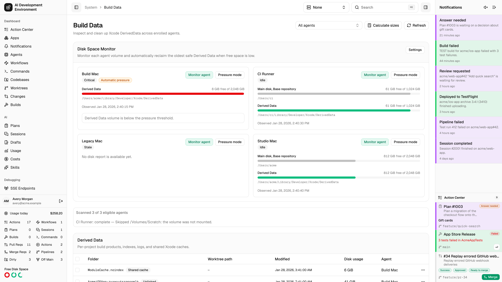
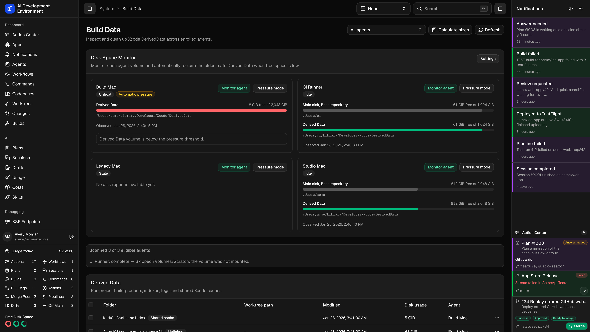
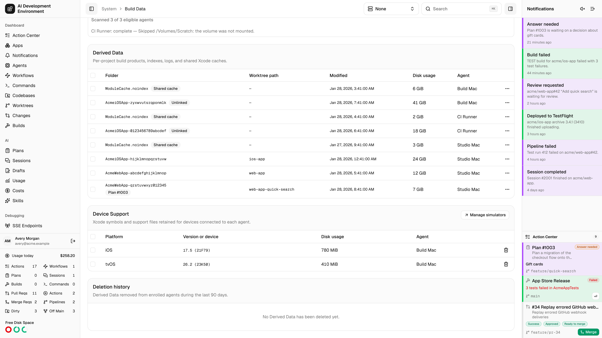
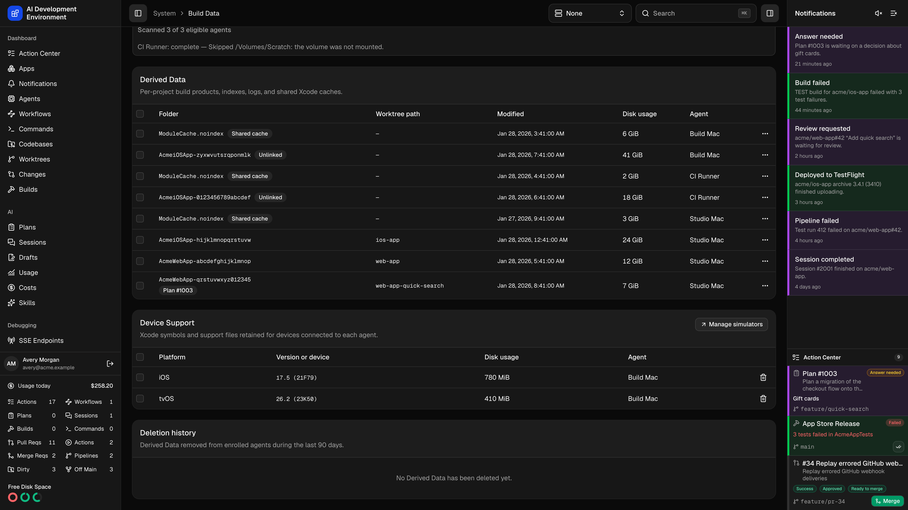

<Frame>
  
  
</Frame>

Open **System → Build Data** at `/system/build-data` to inspect project Derived Data, shared Xcode caches, and support files for devices connected to your Macs.

Choose an agent to scope disk monitoring, scans, and deletion history to that Mac. Choose **All Agents** to scan the fleet. While a global active agent is set, Build Data follows it. Clearing the global selection restores your saved page filter.

## How a scan works

Build Data lists folders when you open the page or switch agents. Measuring sizes takes longer and runs on demand.

<Steps>
  <Step title="Refresh lists the folders" icon="refresh-cw">
    **Refresh** dispatches a scan job to each eligible agent in the current view. Each agent walks its configured Derived Data directories and reports folder names, paths, modification times, and the volume each one lives on. The progress panel shows *Scanned N of M eligible agents* while this runs.
  </Step>
  <Step title="The server links folders to worktrees" icon="link">
    Each folder's recorded workspace path is matched against the [worktrees](/worktrees/worktrees) known for that agent, choosing the longest matching path. That match is what turns a nameless `MyApp-abc123` folder into a row you can act on confidently.
  </Step>
  <Step title="Calculate sizes on demand" icon="calculator">
    **Calculate sizes** sends a second job that measures disk usage for the selected entries. Until then the **Disk usage** column is empty — sizing a large DerivedData tree is slow, so it is never done automatically.
  </Step>
  <Step title="Select and delete" icon="trash-2">
    Select rows and use **Delete selected**, or delete a single row from its actions menu. Deletion is dispatched per agent and always requires an explicit confirmation.
  </Step>
</Steps>

Per-agent scan progress is reported individually, so a single unreachable Mac does not block the rest:

| Agent status | Meaning |
| --- | --- |
| **queuing** / **queued** / **scanning** | The scan job is on its way to the agent, or running |
| **complete** | Results were returned and merged into the table |
| **failed** / **timed out** / **cancelled** | The agent could not finish; the error is shown alongside |
| **offline** | The agent was not connected when the scan started |
| **agent update required** | That agent's control agent is too old to support build-data scans |
| **invalid response** | The agent replied with something the server could not parse |

## Derived Data

Updated agents scan both the configured Xcode DerivedData locations and the managed caches at `<builds-directory>/.worktree-derived-data/<worktree-id>`. A managed cache belongs to one worktree and is reused across that worktree's builds. It is separate from each build's immutable artifact folder. See [Worktree Derived Data](/builds/builds#worktree-derived-data).

| Column | What it shows |
| --- | --- |
| **Folder** | The DerivedData folder name, plus a status badge when it is not a plain linked project |
| **Worktree path** | The worktree this folder belongs to, shown relative to the agent's base repository directory |
| **Modified** | Last modification time — the ordering that matters most when deciding what is safe to remove |
| **Disk usage** | Measured size, once you have run **Calculate sizes** |
| **Agent** | The Mac holding the folder |
| **Actions** | Lock, unlock, or delete this single entry |

### Entry statuses

| Status | Meaning |
| --- | --- |
| *(no badge)* | The folder maps to a worktree that still exists |
| **Unlinked** | No matching worktree — usually a branch that has been deleted. These are the safest deletions and often the largest win |
| **Build starting** | A build has just begun writing this folder; leave it alone |
| **Shared cache** | An Xcode cache shared across projects rather than belonging to one worktree. Deleting it is safe but slows the next build on that machine |

### Locking

**Lock from cleanup** marks an entry as protected. A locked entry is excluded from the automatic reclamation described below, and deleting it by hand requires a second confirmation that lists exactly which folders are protected.

The same protection covers entries with executing work — a build or run currently using that worktree — even when they are not locked.

On agents advertising `operation.resources.v1`, a delete job also reserves the target paths. Confirming protected deletion does not bypass a conflicting active build's path reservation; deletion waits until that build releases it. Older agents do not provide this path coordination.

## Device Support

<Frame>
  
  
</Frame>

Xcode stores symbols and support files for connected devices by platform and operating system version. The **Device Support** card includes the platform folders found on each agent, such as iOS, tvOS, watchOS, and visionOS.

Review the platform, version, and agent before you calculate disk usage or delete a cache. Xcode can recreate the cache the next time a matching device connects. Open [Simulators](/system/simulators) from this card to manage simulator devices and their installed apps.

## Automatic cleanup

The Disk Space monitor in the sidebar can reclaim DerivedData on its own when a monitored volume runs low. It is deliberately conservative:

- Only **project** entries linked to a known worktree are eligible. Unlinked folders, shared caches, and Device Support are never touched automatically.
- Locked entries and worktrees with executing work are excluded, and the check is repeated immediately before deletion in case work started in between.
- Exactly one entry — the **oldest by modification time** on the low volume — is removed per pass, then the monitor waits for the next disk report to decide whether more is needed.

Two thresholds govern it: a **cleanup threshold** below which reclamation begins, and a lower **pressure threshold** used once the volume is in pressure mode. Pressure mode engages automatically when a volume is below the cleanup threshold and nothing safe is left to delete, and can also be set manually per agent.

Everything the monitor removes is recorded in the deletion history with source **Automatic**, so a folder that vanished overnight is always accounted for.

## Deletion history

The **Deletion history** card lists what was removed from each agent over the last 90 days, with the folder, worktree path, agent, deletion time, and whether the source was **User** or **Automatic**. Long histories page with **Load more**.

**Clear History** removes deletion records for the selected agent, or for all agents when **All Agents** is selected.

## Notes

- The agent's DerivedData location setting selects its legacy scan roots. Updated agents also scan the managed cache root beneath the effective Builds directory.
- Deletion requires the target agent to be online at the moment the job is created — an offline agent's entries cannot be removed until it reconnects.
- Sizes are a point-in-time measurement. Rescan before acting on numbers from an earlier session.
- Removing DerivedData never affects source code, worktrees, or Git state. The cost is a slower next build.

## Related pages

<Columns cols={2}>
  <Card title="Worktrees" icon="git-branch" href="/worktrees/worktrees">
    The worktrees that Derived Data entries are matched against.
  </Card>
  <Card title="Builds" icon="hammer" href="/builds/builds">
    The builds that create these folders in the first place.
  </Card>
</Columns>
