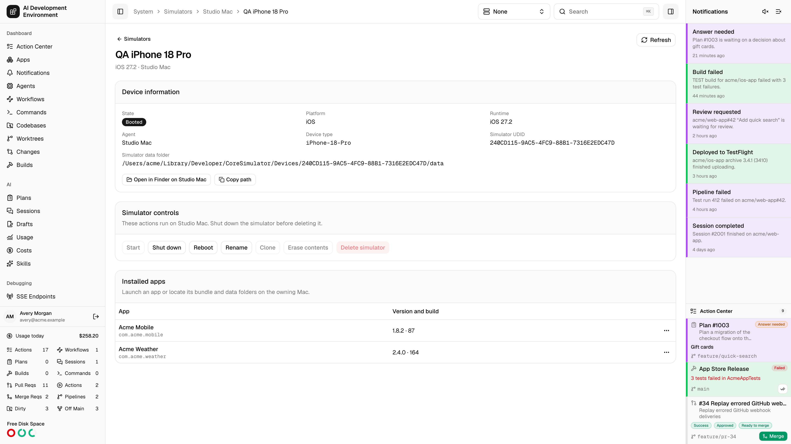
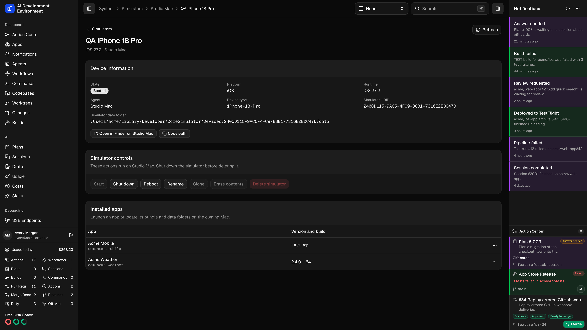

<Frame>
  
  
</Frame>

Select a device from [Simulators](/system/simulators) to see its agent, model, runtime, state, and UUID. The detail stays on that device when you switch the global active agent.

## Manage the device

- **Start**, **Shut Down**, and **Restart** follow the current state of the simulator.
- **Rename** updates the device's name.
- Shut down the simulator before duplicating, erasing, or deleting it. **Duplicate** creates a separate device. **Erase Contents and Settings** clears the simulator's apps and settings and keeps its UUID. **Delete** removes the simulator and its data.

## Inspect installed apps

The **Installed apps** list shows user-installed apps, including their bundle ID and version where available. You can inspect apps on a shut-down simulator. Use **Launch** and **Stop** while the simulator is running.

Use **Reveal App Bundle** to select the bundle in Finder or **Open App Data Folder** to open the app's container. Finder opens on the Mac running the selected agent. The agent needs access to a graphical session. You can also copy the path when a container is available.
