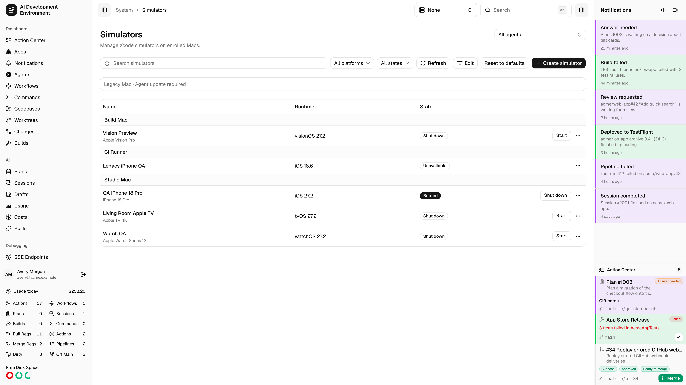
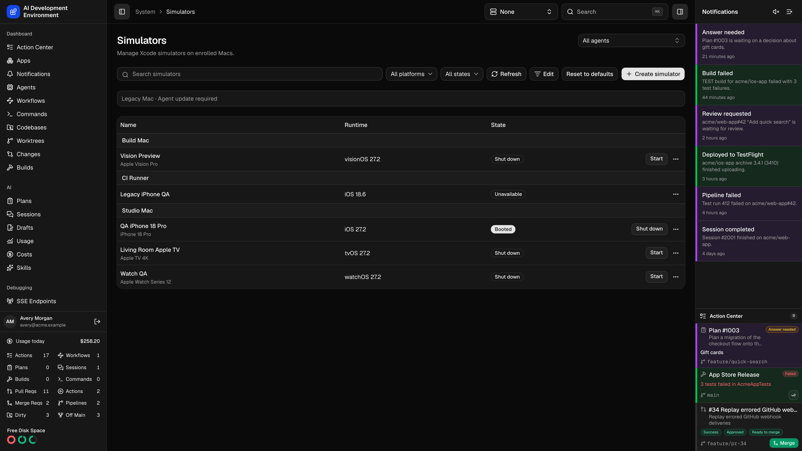
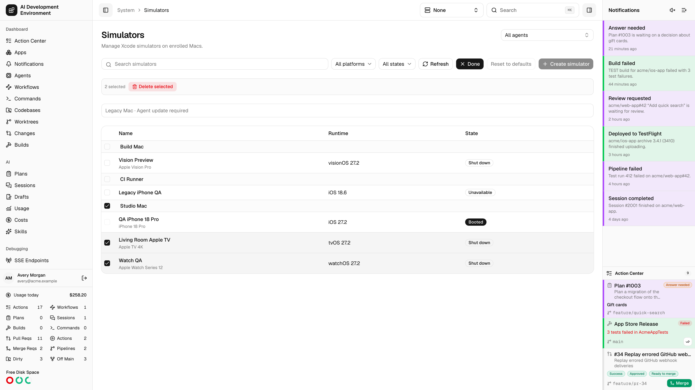
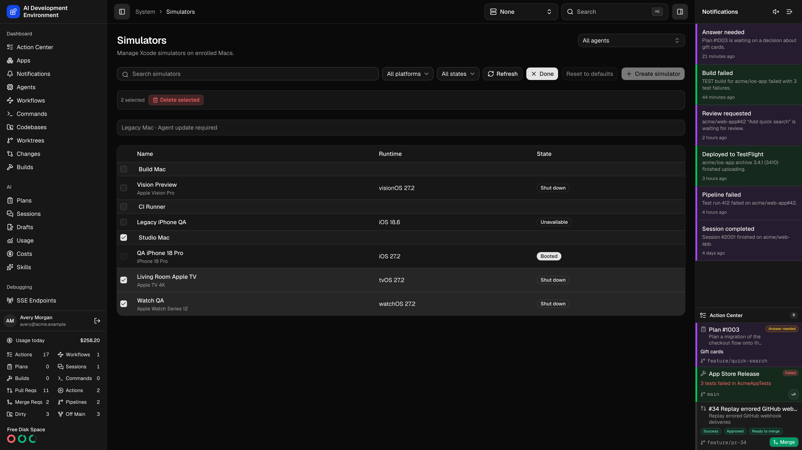

<Frame>
  
  
</Frame>

Open **System → Simulators** at `/system/simulators` or in the iOS and tvOS apps. The list groups devices by agent and shows each simulator's model, runtime, and state. Search the list or filter it by platform and state.

Choose an agent to see its devices, or choose **All Agents** to see the fleet. The global active agent takes precedence while set. When you clear it, the page restores its saved agent filter.

## Create or start a simulator

1. Choose **Create Simulator** and select the target Mac agent.
2. Choose one of its installed runtimes and a compatible device model, then enter a name.
3. Use **Start** or **Shut Down** from the list. Select the simulator name to open its [details](/system/simulator-detail).

An agent needs Xcode and simulator management support. If the agent is offline, reconnect it before refreshing its inventory or sending an action.

## Delete multiple simulators

<Frame>
  
  
</Frame>

1. Choose **Edit** to show selection controls.
2. Select individual simulators, or use the checkbox in an agent's group to select every visible simulator on that Mac that can be deleted. You can select shut-down devices and unavailable devices stuck in **Creating**. Set your filters before selecting devices.
3. Choose **Delete selected**, review the device count, and confirm. This removes the selected devices and their data.

The list refreshes after deletion. If a device could not be deleted, review the error before retrying. Choose **Done** to leave Edit mode.

## Reset to default simulators

Choose **Reset to Default Simulators** for the Mac whose roster you want to replace. Shut down its simulators before confirming. The agent validates the default roster for its installed runtimes, creates the replacements, and removes the original devices.

<Warning>
  Reset removes custom devices and their data, including installed apps and settings. The replacements have new simulator UUIDs. Pairings attached to the removed devices are lost.
</Warning>

If part of the reset fails, read the error and check the refreshed list before retrying. To clear one simulator's apps and settings while keeping its UUID, use **Erase Contents and Settings** on its detail page.
