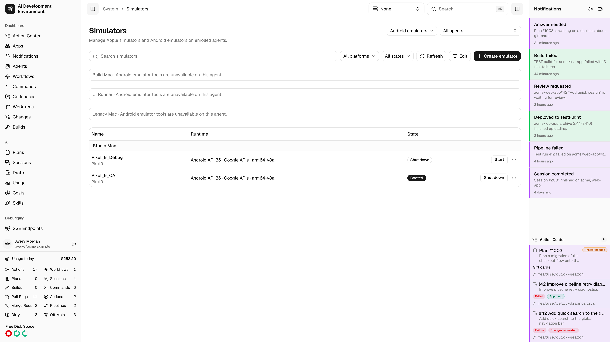
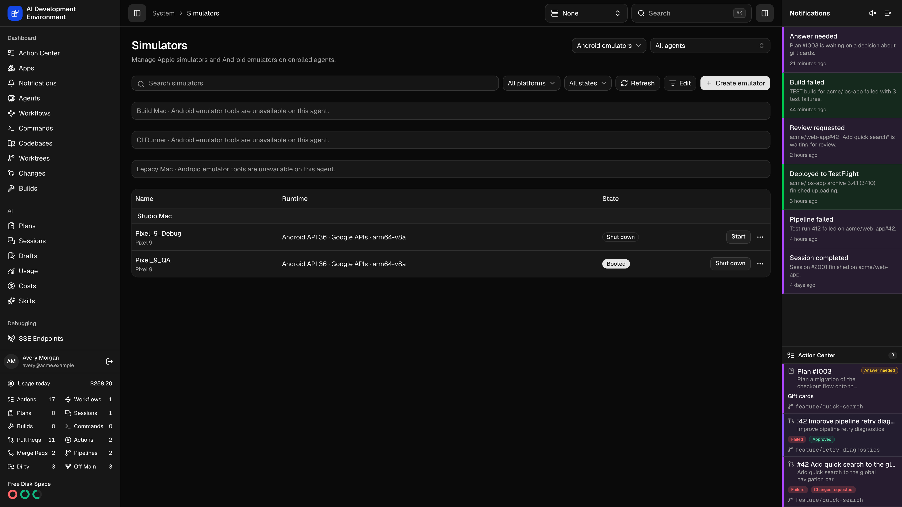
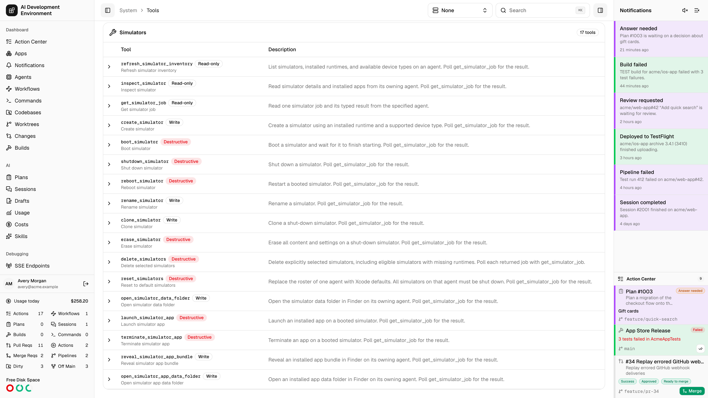
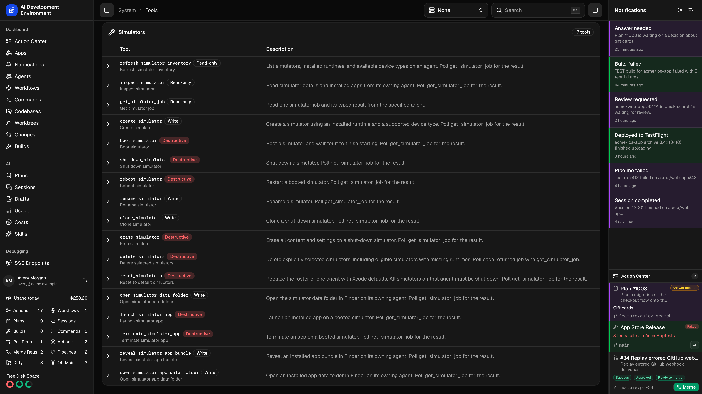

<Frame>
  
  
</Frame>

Open **System → Simulators** at `/system/simulators` or in the iOS and tvOS apps. The list groups devices by agent and shows each simulator's model, runtime, and state. Search the list or filter it by platform and state.

Choose an agent to see its devices, or choose **All Agents** to see the fleet. The global active agent takes precedence while set. When you clear it, the page restores its saved agent filter.

## Create or start a simulator

1. Choose **Create Simulator** and select the target Mac agent.
2. Choose one of its installed runtimes and a compatible device model, then enter a name.
3. Use **Start** or **Shut Down** from the list. Select the simulator name to open its [details](/system/simulator-detail).

An agent needs Xcode and simulator management support. If the agent is offline, reconnect it before refreshing its inventory or sending an action.

## Manage Android emulators

<Frame>
  
  
</Frame>

Choose **Android emulators** on the web, or **Android Emulators** in the native app. Install Android Emulator, SDK Platform Tools, SDK command-line tools, and a compatible Android system image on the agent first. The emulator runs under the same account as the agent.

Create an emulator by selecting an agent, an installed system image, and a device profile. Use **Start** and **Shut Down** from the list, or open a device to inspect it and manage its apps. Shut down an emulator before renaming, duplicating, erasing, or deleting it. Duplicating an Android emulator creates a fresh device with the same profile and system image.

[Android Emulator command line](https://developer.android.com/studio/run/emulator-commandline) · [Android Virtual Device manager](https://developer.android.com/tools/avdmanager)

## Delete multiple simulators

<Frame>
  
  
</Frame>

1. Choose **Edit** to show selection controls.
2. Select individual simulators, or use the checkbox in an agent's group to select every visible simulator on that Mac that can be deleted. You can select shut-down devices and unavailable devices stuck in **Creating**. Set your filters before selecting devices.
3. Choose **Delete selected**, review the device count, and confirm. This removes the selected devices and their data.

The list refreshes after deletion. If a device could not be deleted, review the error before retrying. Choose **Done** to leave Edit mode.

## Reset to default simulators

Choose **Reset to Default Simulators** for the Mac whose roster you want to replace. Shut down its simulators before confirming. The agent validates the default roster for its installed runtimes, creates the replacements, and removes the original devices.

<Warning>
  Reset removes custom devices and their data, including installed apps and settings. The replacements have new simulator UUIDs. Pairings attached to the removed devices are lost.
</Warning>

If part of the reset fails, read the error and check the refreshed list before retrying. To clear one simulator's apps and settings while keeping its UUID, use **Erase Contents and Settings** on its detail page.

## Automate simulators with MCP

<Frame>
  
  
</Frame>

Open the **Simulators** group in [Tools](/system/tools) or discover it in your MCP client. Use `agentId` to choose the Mac. Use the simulator UUID as `simulatorId` for device and app operations, and use `bundleId` for app operations. Creation uses `name`, `runtimeId`, and `deviceTypeId` from the target agent's inventory.

| Permission | Tools |
| --- | --- |
| Read | `refresh_simulator_inventory`, `inspect_simulator`, `get_simulator_job` |
| Write | `create_simulator`, `rename_simulator`, `clone_simulator`, `open_simulator_data_folder`, `reveal_simulator_app_bundle`, `open_simulator_app_data_folder` |
| Destructive | `boot_simulator`, `shutdown_simulator`, `reboot_simulator`, `erase_simulator`, `delete_simulators`, `reset_simulators`, `launch_simulator_app`, `terminate_simulator_app` |

1. Queue `refresh_simulator_inventory` with the target `agentId` and a `requestId` you generate. The response gives you a `jobId`.
2. Poll `get_simulator_job` with the same `agentId` and the returned `jobId`. `QUEUED`, `RUNNING`, and `CANCELLING` mean the operation is still in progress. On `SUCCEEDED`, read `job.inventory` for devices, runtimes, and compatible device types. On failure, review `job.error`.
3. Queue `inspect_simulator` with the agent, a simulator UUID from inventory, and a new `requestId`. Poll its job and read `job.details` for the simulator and its installed apps. Boot the simulator to load the full app list.

Create and clone jobs return the resulting device UUID in `job.simulatorId`. Inspection can include paths on the owning Mac. Finder tools open those locations on that Mac.

Keep `requestId` stable when retrying the same submission. Choose a new ID when changing the operation or its inputs. Erase, delete, and reset require `confirm: true`. `delete_simulators` accepts 1 to 200 `{ agentId, simulatorId }` pairs in `targets` and returns a job or queue error for each target. Poll each accepted job to confirm deletion. A run-scoped tool call can target only the run's own agent, including every target in a bulk deletion.

To wait for simulator work and pass its results to subsequent actions, use [simulator workflow steps](/workflows/workflow-edit#automating-simulators).
