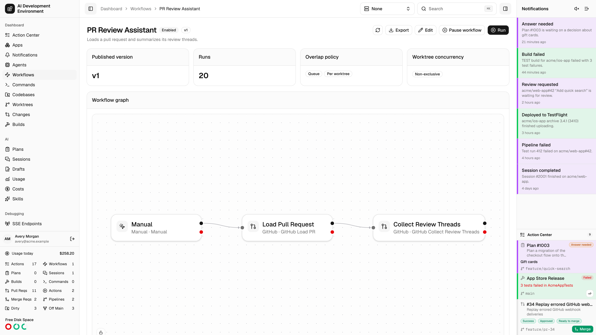
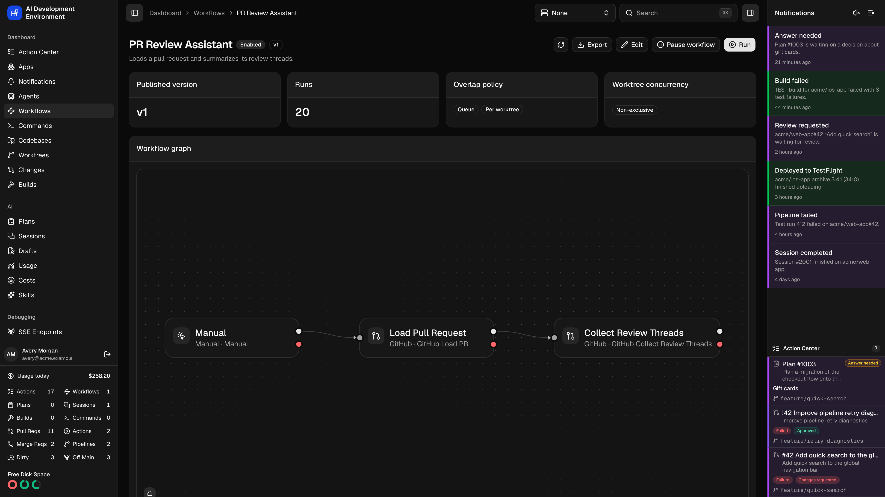

<Frame>
  
  
</Frame>

The workflow details page at `/dashboard/workflows/{id}` is the read-only view of one workflow: what is published, what the graph looks like, how it behaves under load, where it shows up as a button, and what it has run recently.

## Header

The name, description, and an **Enabled** or **Disabled** badge, with the top-level actions:

| Action | Effect |
| --- | --- |
| **Run** | Starts a run of the published version |
| **Edit** | Opens the [workflow editor](/workflows/workflow-edit) |
| **Export** | Downloads the current definition as a file |
| **Enable** / **Pause workflow** | Controls whether triggers can start runs |
| **Refresh** | Refetches the page |

## Summary cards

<Columns cols={2}>
  <Card title="Published version" icon="tag">
    The version number currently in force. Runs always execute a published version, never the working draft.
  </Card>
  <Card title="Runs" icon="list">
    How many runs this workflow has produced.
  </Card>
  <Card title="Overlap policy" icon="layer-group">
    What happens when a trigger fires while a run is already in flight — **Queue** every event, run **Concurrent**, or keep only the **Latest** pending event — and the [scope](/workflows/workflow-edit#overlap-scope) it is measured in, **Per worktree** or **Every worktree**. A concurrent workflow also shows its maximum. The card spells out what the combination means in a sentence.
  </Card>
  <Card title="Worktree concurrency" icon="lock">
    Shows whether top-level runs use **Exclusive**, **Non-exclusive**, or **Excluded** admission. A separate **Blocks Git operations** badge appears when command and terminal steps serialize with Git and worktree operations.
  </Card>
</Columns>

## Workflow graph

A read-only rendering of the published graph, using the same node styling as the editor. Steps are drawn with their category icon, so a Jira step reads the same here as it does on the canvas.

Whether the graph honors the positions you authored or auto-arranges for the available width is controlled by the **Viewer layout** setting in the editor.

### Draft diagnostics in iOS

The native iOS workflow detail shows the saved draft's steps and connections. Loading or refreshing the detail also checks that draft on the control plane and displays every returned diagnostic.

Diagnostics name the affected step or the connection's source, output branch or choice, and destination. Errors highlight the related step or connection rows in red; warnings use orange. Tap a diagnostic to scroll to its related row. Workflow-wide errors without a target remain informational rows.

Choose **Edit Draft** to repair the definition through the native editor's advanced JSON controls, then return to or refresh the detail to review the saved result. The web [workflow editor](/workflows/workflow-edit#validate-save-publish) provides the canvas and checks edits locally after 200 ms.

## Quick actions

This is where you decide whether the workflow appears as a button on other pages, and where.

<Steps>
  <Step title="Choose an action type" icon="arrow-pointer">
    | Type | Where the button appears |
    | --- | --- |
    | **Standard** | Alongside the normal worktree actions |
    | **Merge conflict** | Starts while a worktree rebase is stopped on conflicts; active runs remain accessible after resolution |
    | **GitHub Actions** | In matching GitHub pipeline and job menus |
    | **None** | Nowhere — the workflow is run from its own page only |
  </Step>
  <Step title="Style the button" icon="palette">
    Pick a **Button icon** and a **Button style** — Default, Outline, Secondary, or Destructive.
  </Step>
  <Step title="Scope it to repositories" icon="folder-tree">
    Leave every repository unchecked to allow all of them, or select specific repositories to build an allowlist. You need at least one codebase registered before this list has anything in it.
  </Step>
  <Step title="Save" icon="floppy-disk">
    **Save quick actions** applies the configuration.
  </Step>
</Steps>

On web worktree cards and table rows, a running merge-conflict action keeps its workflow button and **Manage running** control after conflicts clear or the rebase finishes. You can still open or manage the run while later steps complete. Other inactive merge-conflict actions are hidden until a rebase needs them again. The **Rebase paused** warning and **Cancel rebase** control disappear when the rebase ends.

<Note>
  A quick action only renders when the workflow is published, enabled, and has a resource trigger matching the selected action type. All four conditions have to hold — the page states this inline as a reminder.
</Note>

## Queue

The **Queue** card collects queued workflow runs and queued AI runs launched by this workflow. Each row shows its effective position, run and phase, worktree, queued time, and worktree concurrency mode.

Positions are relative to all queued work on each worktree, even though this card only includes entries associated with the current workflow. Open the linked worktree to see the complete combined queue.

<Note>
  The card lists queued work, not runs that are already active. Plan and Session lanes can advance independently until an exclusive workflow reaches the front of the combined admission order.
</Note>

## Recent runs

The latest runs with their number, status, trigger, and start time. Each links to the [workflow run page](/workflows/workflow-run). Runs that have not started yet show as **Queued**.

## Version history

Every published version, listed with its version number, **content hash**, and publish time. The content hash identifies the exact definition bytes, which makes it easy to confirm two control planes are running the same workflow.

**Export version** downloads any prior version, so you can inspect or restore an older definition.

<Tip>
  Published versions are immutable. Editing a workflow changes its draft; the running behavior does not change until you publish again.
</Tip>

## Related pages

<Columns cols={2}>
  <Card title="Workflow editor" icon="pencil" href="/workflows/workflow-edit">
    Change the graph, step configuration, and workflow settings.
  </Card>
  <Card title="Workflows" icon="diagram-project" href="/workflows/workflows">
    The index of all definitions and all runs.
  </Card>
</Columns>
