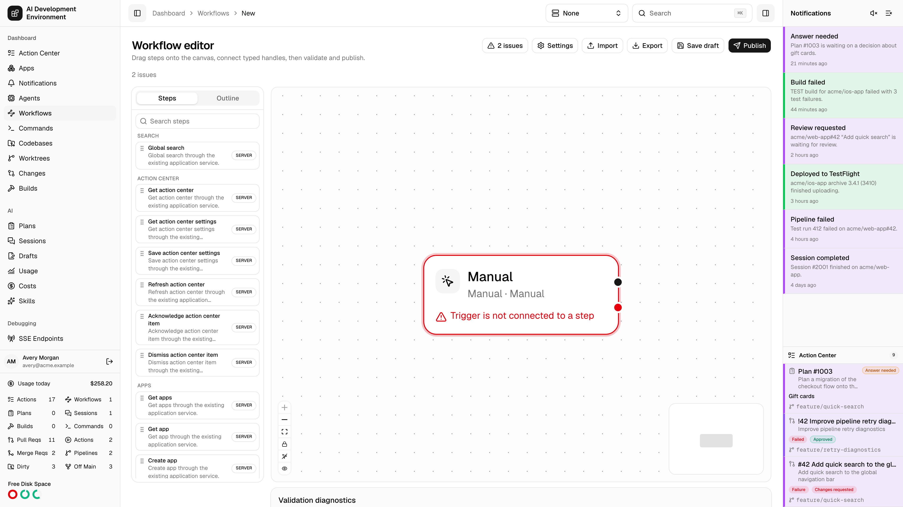
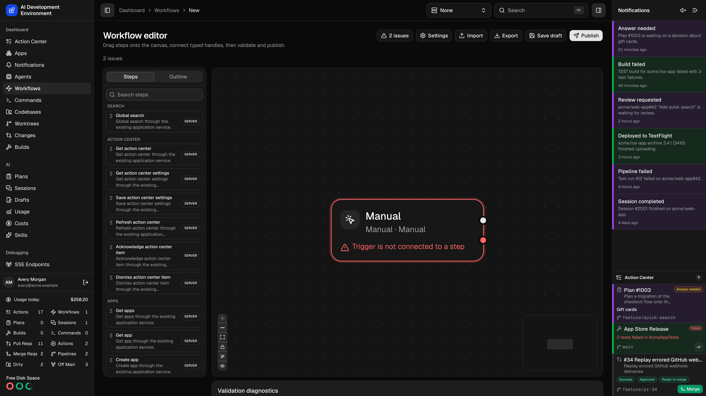

<Frame>
  
  
</Frame>

The new workflow page at `/dashboard/workflows/new` opens the [workflow editor](/workflows/workflow-edit) on an empty canvas. It is the same editor you get when editing an existing workflow — this page just starts you from nothing.

## Building your first workflow

<Steps>
  <Step title="Name it" icon="font">
    Open **Workflow settings** and give the workflow a name and description. Both show up wherever the workflow is listed or offered as a button. Its **Running** section also controls overlap, the [scope](/workflows/workflow-edit#overlap-scope) that overlap is measured in, worktree admission, and whether command-like steps block Git operations.
  </Step>
  <Step title="Add a trigger" icon="play">
    Keep the default **Manual** trigger if you want to run the workflow by hand, or add a **Resource** trigger to launch it from a worktree, pull request, or ticket page. A workflow can have several triggers, each connected to an entry path.
  </Step>
  <Step title="Add steps" icon="code-fork">
    Drag steps from the palette and connect each one's handles. Most steps offer `success` and `failure`; control-flow steps name their own branches.
  </Step>
  <Step title="Configure each step" icon="sliders">
    Fill in the typed configuration form. Bind values to session data where a step should read something an earlier step produced, rather than hard-coding it.
  </Step>
  <Step title="Validate" icon="circle-check">
    The web editor checks edits locally after 200 ms. Click **Validate** to save the current canvas and run the server checks. Click a diagnostic to reveal its affected step, trigger, or connection; see [Finding workflow errors](/workflows/workflow-edit#find-the-affected-connection-or-step).
  </Step>
  <Step title="Save, then publish" icon="upload">
    **Save draft** keeps your work. **Publish** creates the first immutable version — until then the workflow has nothing to run.
  </Step>
</Steps>

Your first save changes the page to the saved workflow's editor while keeping any newer edits you made during the request. Changes made during validation need a new check before publishing.

## What a valid workflow needs

- At least one trigger, with no incoming connection; each trigger must connect to a step.
- At least one step, with every step reachable from a trigger.
- An acyclic graph with no unreachable steps.
- Parallel branches reconverged through an explicit join.
- Every step's required session paths provided by something upstream.
- No secrets typed as literals.

<Tip>
  Import is often faster than starting blank. On the [Workflows](/workflows/workflows) page, **Import** loads an exported definition as a draft — a good way to adapt a workflow from another control plane.
</Tip>

<Note>
  A new workflow is a draft until you publish it, and its triggers do not fire until it is also enabled.
</Note>

## Related pages

<Columns cols={2}>
  <Card title="Workflow editor" icon="pencil" href="/workflows/workflow-edit">
    The full reference for the canvas, step configuration, settings, and diagnostics.
  </Card>
  <Card title="Workflows" icon="diagram-project" href="/workflows/workflows">
    The index of definitions and runs, plus import and export.
  </Card>
</Columns>
