<Frame>
  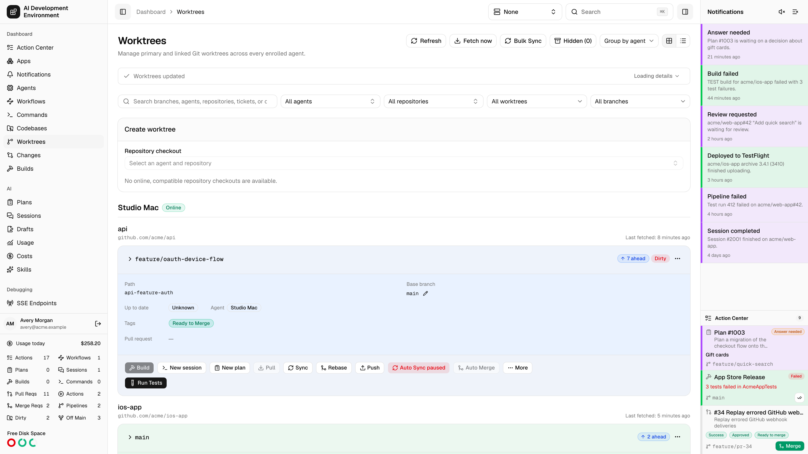
  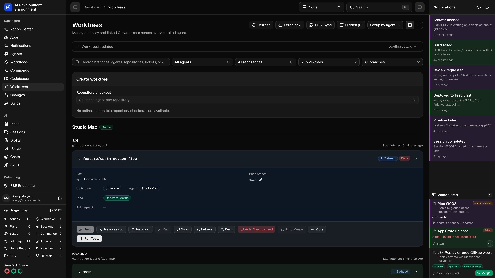
</Frame>

The **Worktrees** page at `/dashboard/worktrees` is the busiest page in the product. It shows every primary and linked Git worktree across every enrolled machine, and gives each one a full set of Git operations, automation toggles, and links to the GitHub pull request or GitLab merge request, build, and AI work attached to it.

## Finding a worktree

- **Search** across branches, agents, repositories, tickets, and codebases.
- **Filter by agent** and **filter by repository** using searchable dropdowns on the web. Search agents by name or hostname, and repositories by name or origin. Choose **All agents** or **All repositories** to clear a filter. On the web, long selected names and options use ellipses; hover to read their full text. This also applies to Worktrees inside apps.
- **Filter by changes** narrows the list to **Dirty worktrees** or **Clean worktrees**. A worktree counts as dirty when it has staged or unstaged changes — the same rule behind its **Dirty** badge.
- **Filter by branch** can show only worktrees **Not on default branch**. The filter uses the repository’s remote default and configured default-branch patterns.
- Use **Group by agent** or **Group by repository** to choose the primary grouping. The other dimension remains visible on each worktree. Default-branch worktrees follow all other worktrees within the chosen group, including worktrees from other nested checkouts.
- Switch between **Card layout** and **Table layout**.
- **Refresh** re-reads status; **Fetch now** runs `git fetch origin` for eligible codebases.

Your search, changes filter, branch filter, grouping, and layout are saved in the browser and restored the next time you open the page. Filters combine, so you can show, for example, dirty worktrees that are also off their default branch. A saved agent or repository filter is ignored if that item no longer exists. The worktrees view inside an [app](/apps/app-detail) keeps its own saved filters, separate from this page's. The iOS Worktree Actions menu offers the same changes and branch filters for the current visit.

The web sidebar's **Dirty** counter opens `/dashboard/worktrees?changes=dirty&branches=all`. **Off Main** opens `/dashboard/worktrees?changes=all&branches=non-default`. These URL parameters take precedence over remembered changes and branch filters, and the resulting selection is saved in the browser. Other filters and active-agent scope still apply. Changing a filter updates its URL parameter when present. See [Worktree counters](/dashboard#worktree-counters) for how the totals are calculated.

### Loading and retrying details

In the web app, saved worktrees appear first. GitHub pull requests, GitLab merge requests, GitLab pipelines, and Jira summaries then update independently, including in an app's Worktrees view. A slow integration does not block the worktree list.

Open **Loading details** above the filters to inspect each stage's status, elapsed time, server processing time, and warnings. Elapsed time includes request queueing and network time. **Updated with warnings** means some details could not refresh; use **Try again** beside the affected stage to retry it independently. A failed **Saved worktrees** stage has its own retry.

Previously loaded details remain visible during a failed refresh while the worktree still represents the same repository, branch, and commit. Failed GitLab approval or discussion lookups preserve the last successful value only for the same merge request and head commit; newly discovered requests remain visible even if an optional summary fails. Review the warning before relying on an older value.

### Use the active agent

The [Active Agent selector](/index#focus-on-an-agent) applies to this page and Worktrees views inside apps. When selected, it locks **Filter by agent** to that agent while preserving each view's previous choice. Select **None** globally to restore it, including after reopening the page. Search, repository, changes, and branch filters still combine with the active agent. An agent without matching worktrees shows **No matching worktrees**.

<Frame>
  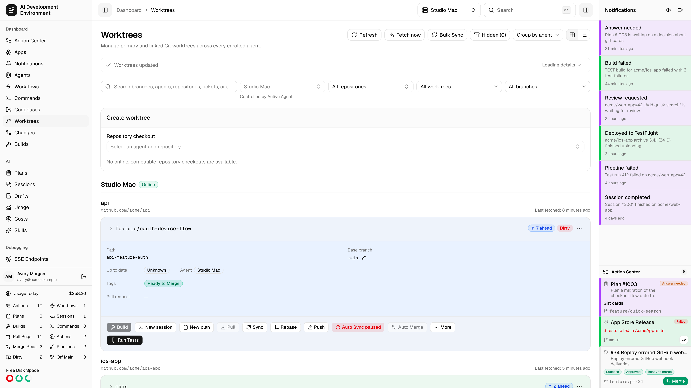
  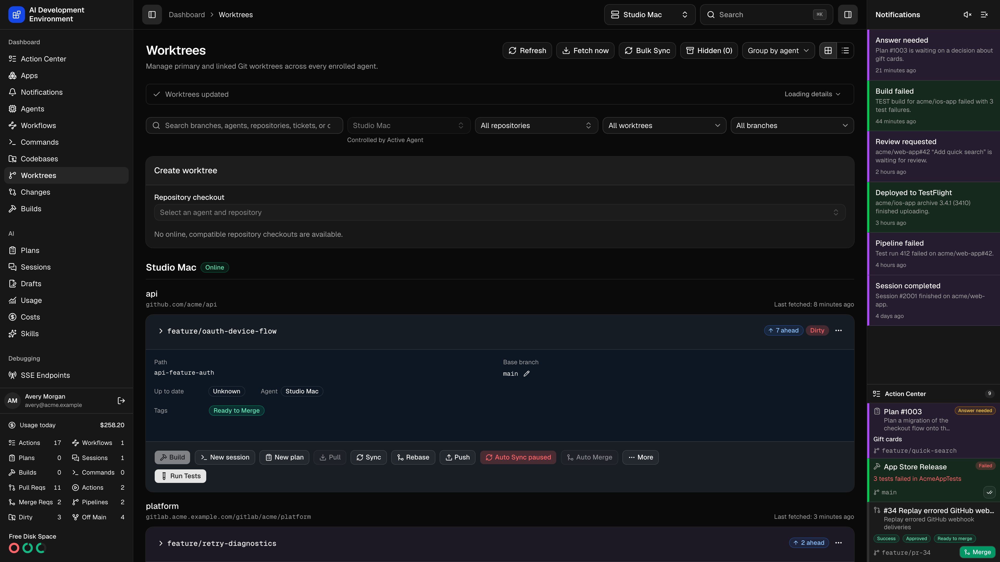
</Frame>

In iOS, the dedicated toolbar icon opens the same global selection. The Worktree Actions menu shows the locked agent filter and its explanation. The app saves the underlying agent choice separately for each Worktrees view.

Each worktree shows its branch, path, base branch, agent, repository, upstream status, base freshness, nonzero commit counts, and latest build where available. Cards omit the pull-request summary line; open worktree details for the full request information. Tables retain their request details.

<Tip>
  **Manage tags** creates reusable global tags with badge colors, and **Highlight** assigns a worktree a color that follows it everywhere — the Action Center, notifications, and run pages all pick it up. The palette includes lavender, maroon, brown, olive, and navy. Use the trash button beside **Highlight** to clear the current color.
</Tip>

### Status at a glance

| Indicator | Values |
| --- | --- |
| Upstream status | Ahead, behind, diverged, in sync, unpublished, detached |
| Base freshness | Current with an ahead count, or a count of commits behind base |
| Working tree | Dirty when staged or unstaged changes exist; otherwise clean |
| Review decision | Approved, changes requested, review requested, review required, or no decision |

## Default branches

<Frame>
  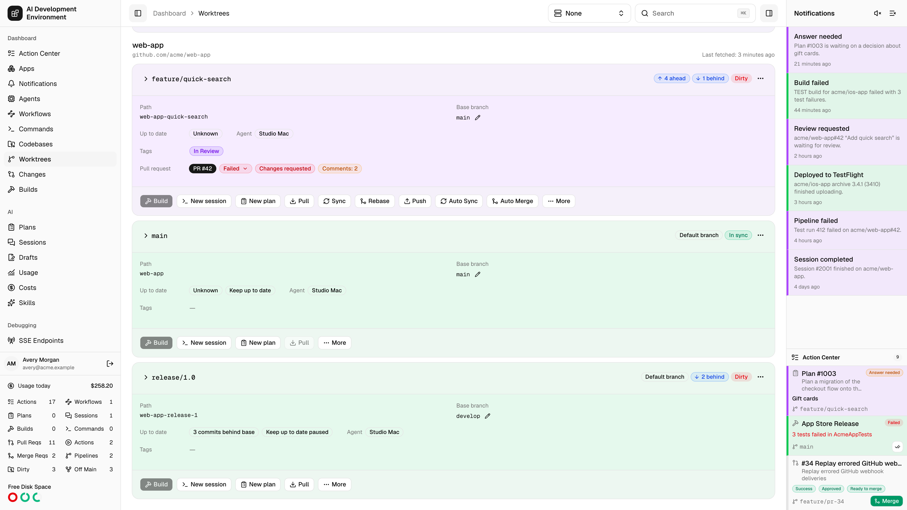
  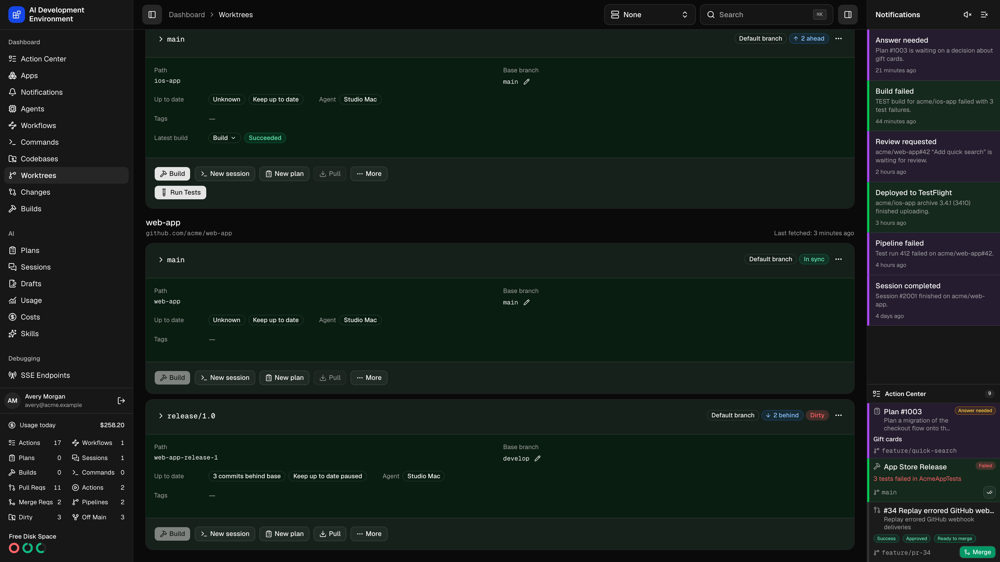
</Frame>

The remote default branch and any branches matching **Default branch matches** in [Repository details](/codebases/repository-detail) use a compact card with a **Default branch** badge. Cards and table rows use a light gray highlight when you have not assigned a color; an explicit highlight takes precedence. The iOS worktree cards show the same badge and fallback tint. **Sync**, **Rebase**, and **Push** are available from **More**, while **Auto Sync** and **Auto Merge** controls are hidden. Default branches remain below other worktrees within the selected agent or repository group.

Enable **Keep default branches up to date** in repository settings to update clean default-branch worktrees after fetches. Updates only fast-forward from the same-named `origin` branch. A different comparison base still supplies the displayed base-behind count, but is never rebased or synced into the branch by this setting. Local commits, divergence, and dirty files are preserved. Dirty worktrees show paused updates until they become clean again.

Switching to a branch that is not a default stops this automatic maintenance and restores the ordinary card and automation controls. A default branch behind its comparison base shows **N commits behind base** in a neutral badge. The native iOS app uses the same classification, ordering, maintenance status, and controls.

## Review details

<Frame>
  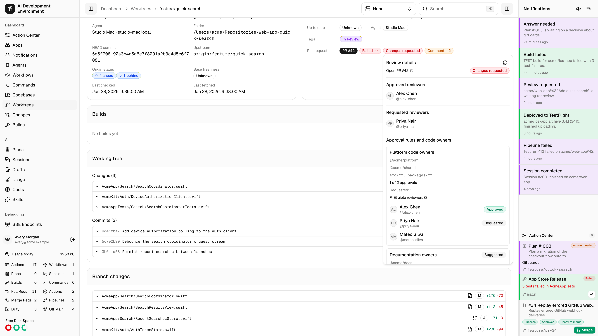
  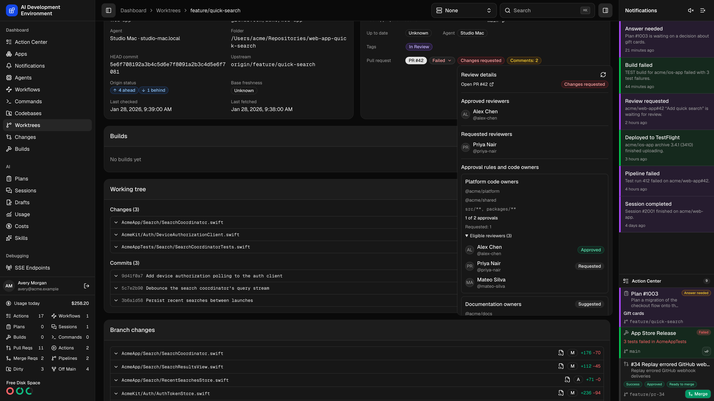
</Frame>

In the web app, select a worktree's review badge, such as **Review required** or **Approved**, to open review details without leaving the card. The same popover is available in worktree table rows, worktree details, app worktrees, and the worktree status card on Plan and Session pages.

When a GitHub PR or GitLab MR requires review, the badge shows **Review requested** if reviewers are assigned and **Review required** if none are assigned.

The popover lists **Approved reviewers** and **Requested reviewers** separately, with names, usernames, and avatars. Applicable approval rules show their code-owner groups, file patterns, distinct approved count, and required approval count. Select **Load all reviewers**, then expand **Eligible reviewers** to inspect group members and their **Approved** or **Requested** labels. A pending request does not count as an approval.

<Frame>
  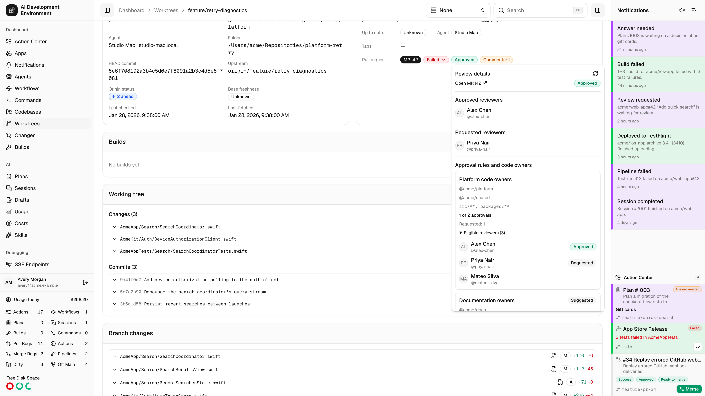
  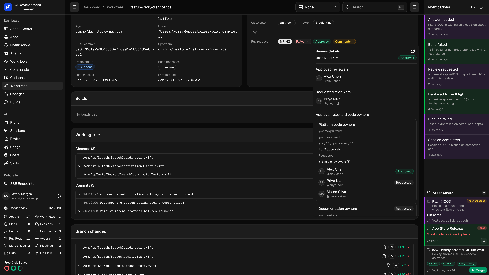
</Frame>

GitLab rules retain their provider grouping: multiple contributing groups do not create separate approval quotas. People can contribute to overlapping rules when eligible. Optional ownership reviews show **Suggested** without an enforced approval target.

You can inspect a linked open, closed, or merged request without configuring preferred reviewers. **Refresh review details** loads current provider data; the request link opens GitHub or GitLab. Missing permissions or incomplete discovery appear alongside available details. Refresh and retry after a failed read. Escape or an outside click closes the popover.

This view is read-only. Use **Assign** below to request reviewers. API clients can load the same details with `worktreeReviewStatus(worktreeId:)` using control-plane authentication; agent credentials cannot call it.

## Assign reviewers

<Frame>
  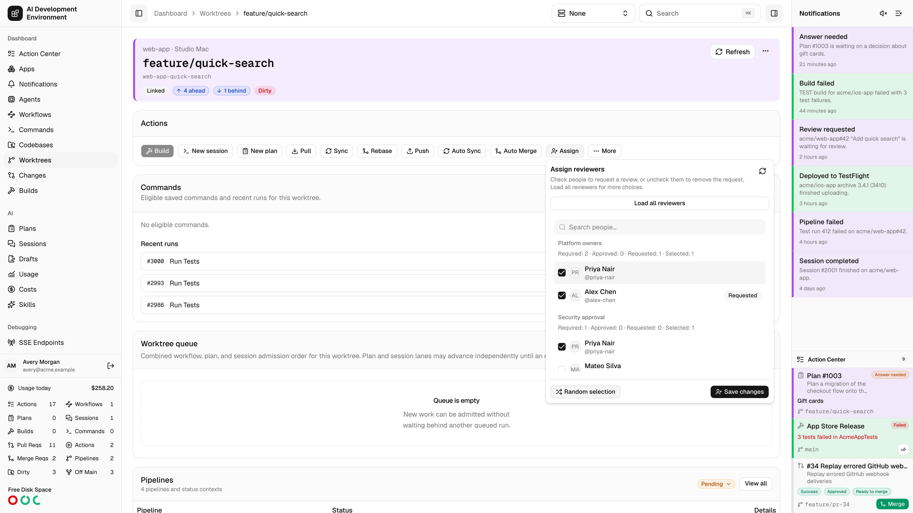
  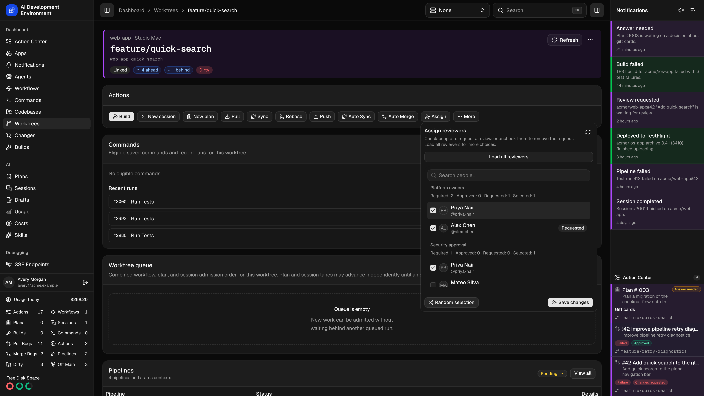
</Frame>

**Assign** appears when the worktree has an open GitHub pull request or GitLab merge request and its [repository Code reviewers settings](/codebases/repository-detail) contain preferred people. The action is shared by worktree cards, table rows, worktree details, app worktrees, and worktree actions on plan and session pages. It contacts the provider through the control plane, so the local agent does not need to be online.

Open **Assign**, search people, and select one or more reviewers under the applicable ownership and approval groups. Each group distinguishes **Required**, **Approved**, **Requested**, and **Selected** counts. A requested reviewer has not approved yet. Existing reviewers and approvals remain visible; checked requests are retained and unchecked requests are removed when you save. You can assign part of the required group and add more later.

**Random selection** fills remaining reviewer targets from your configured, currently eligible people. Existing valid approvals, pending requests, and your selections contribute to those targets. One person can cover overlapping groups when eligible for each. A rule requiring two approvals needs two distinct people. Random selection only prepares the list: review it, then select **Save changes** to update requests.

The request author, bots, ineligible people, existing requested reviewers, and people with valid approvals are excluded from new requests. If the configured pool is too small, the picker explains which targets remain short. Discovery or permission issues remain visible. A successful selection is a request for review; the provider remains responsible for accepting approvals and enforcing merge rules.

<Frame>
  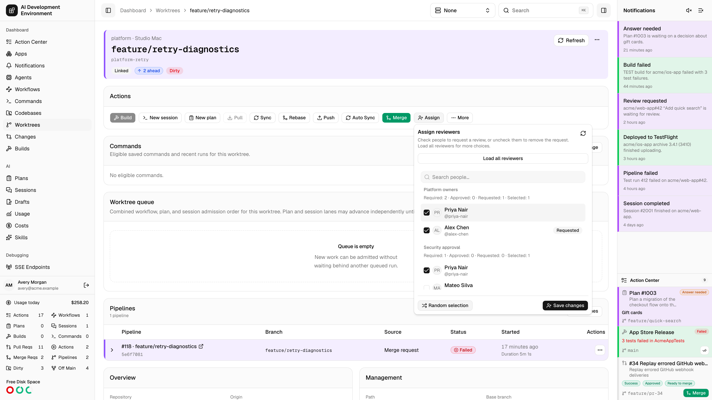
  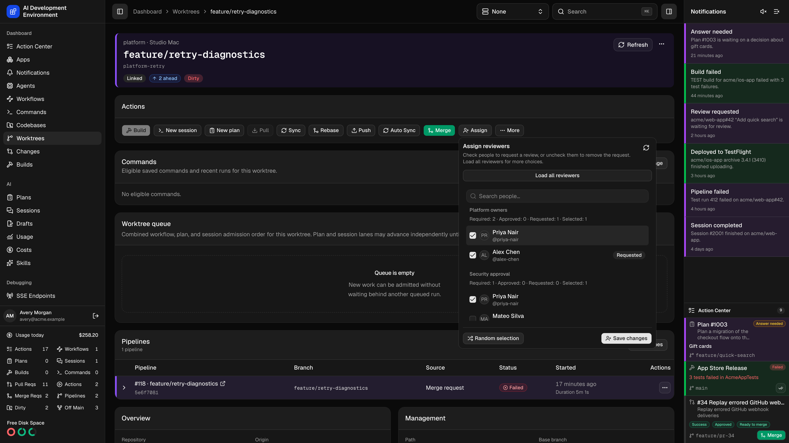
</Frame>

The server checks the request and eligibility again before assigning. If the PR or MR closed, the worktree switched requests, or permissions changed, reload the options and retry. After an assignment error, the web picker reloads provider state before another attempt. The native iOS app offers the same settings, group counts, random preview, and additive assignment from worktree actions.

For API clients, `repositoryCodeReviewers` discovers pools and `saveRepositoryCodeReviewers` stores preferences. Load `worktreeReviewerAssignment(worktreeId:)` before selecting people. Pass its provider request identity in `requestId` to `previewRandomWorktreeReviewers` or `assignWorktreeReviewers`; do not generate a new identity. Random preview is a query and sends no review requests. The assignment mutation accepts the selected `reviewerIds` and requires control-plane authentication.

In the web app, **Assign** sits immediately before **More**. The picker initially loads preferred people and current review requests. Requested people start checked. Check people to request a review or uncheck them to remove the request, then select **Save changes**. You can remove the last requested reviewer; existing approvals are unaffected.

Use **Load all reviewers** to select other provider-eligible people without changing repository preferences. **Random selection** continues to use preferred pools. A failed save reloads provider state before another attempt, including when only part of a provider update succeeded.

Directory membership is cached separately from approvals and requests for 24 hours, refreshed on demand. **Refresh** bypasses directory caching. If a directory refresh fails, retained membership can be displayed with a stale notice. Eligibility of additions is checked again before writing. Inspect GitLab directory freshness on [GitLab Cache](/gitlab/cache).

## Creating a worktree

<Steps>
  <Step title="Choose the repository checkout" icon="folder-tree">
    Pick the agent checkout that will own the worktree. Only online, compatible checkouts are offered.
  </Step>
  <Step title="Choose the branch source" icon="code-branch">
    - **New branch** — name a branch and pick a base.
    - **Existing branch** — choose a local branch, an origin branch, or one that exists in both.
    - **From ticket** — enter a Jira ticket key and use its Jira project’s JavaScript or AI naming configuration. The repository’s Jira regex identifies linked tickets from names; it does not generate names.
  </Step>
  <Step title="Pick a base branch" icon="code-merge">
    Select a base, or inherit the remote default.
  </Step>
  <Step title="Create" icon="check">
    The agent creates the worktree, applies the repository's preparation rules, and reports it back. If preparation fails, AIDE removes the incomplete worktree and removes only a branch created by that job.
  </Step>
</Steps>

## Ticket branch naming

<Frame>
  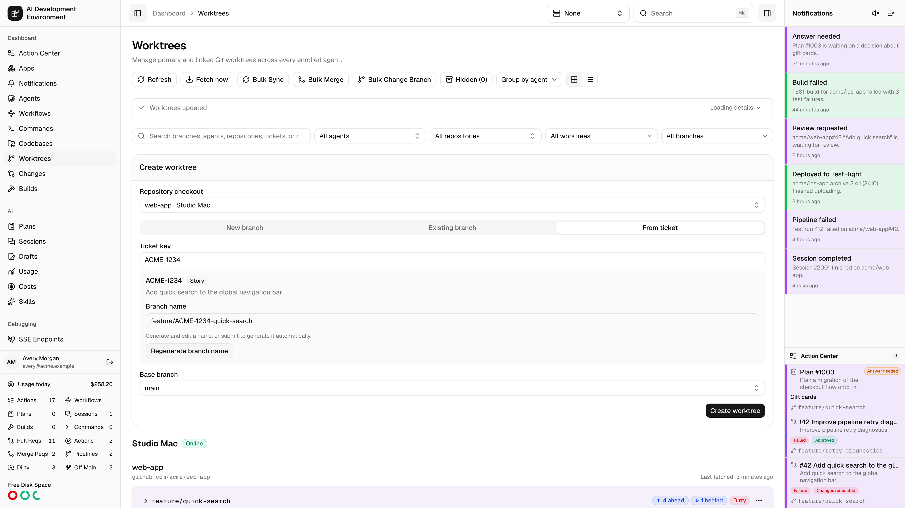
  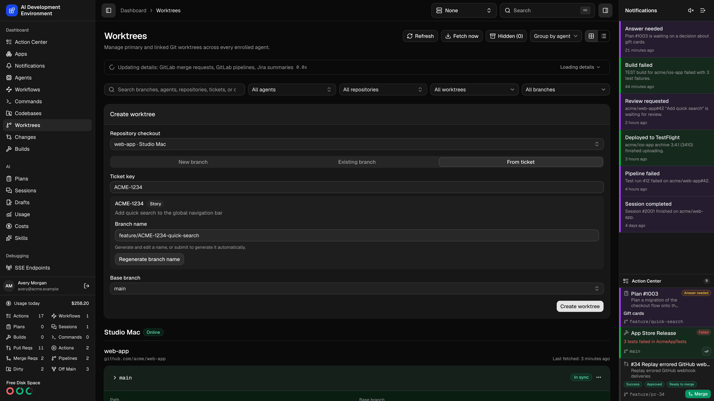
</Frame>

The **From ticket** tab loads ticket metadata without calling a model. For projects using [AI branch naming](/jira/jira-tickets#ai-branch-naming), select **Generate branch name** to fill an editable branch field. **Regenerate branch name** requests another suggestion. Creating or changing a branch uses your preview, including edits, without generating it again.

You can leave the name empty and submit **Create worktree** or **Change branch** directly. The agent generates and validates the name in the background before making Git changes or stashing files. The form shows progress and keeps generation failures visible for retry. There is no automatic JavaScript fallback.

<Frame>
  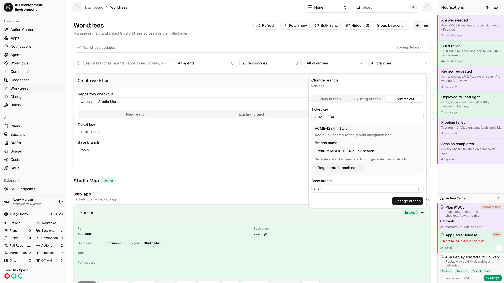
  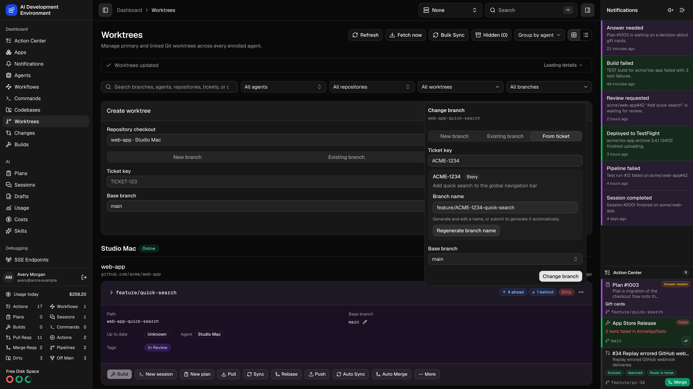
</Frame>

The name is checked against recorded branches across the repository and checked again in Git when the job runs. A taken name receives `-2`, `-3`, and subsequent numeric suffixes, with up to 100 candidates and the existing 255-character branch limit. Changing the ticket or target discards its preview. Generation errors, invalid output, and a 120-second generation timeout stop before Git changes.

The iOS **Create Worktree** and **Change Branch** forms offer the same previews and editable generated names. They wait for the branch job to finish before dismissing, keeping errors in the form.

### GraphQL and MCP

`worktreeTicketBranchContext(input:)` returns ticket metadata, `branchNamingMode`, and a JavaScript preview when applicable without invoking AI. `generateWorktreeTicketBranch(input:)` accepts `codebaseId`, optional `worktreeId`, `ticketKey`, and a client-generated `requestId`, and returns an `AgentJob` immediately. Poll `agentJob` or subscribe to its changes; a successful generation exposes `worktreeTicketBranchResult { branchName }`.

Pass that name or an edited value in `WorktreeBranchSelectionInput.branchName` with `mode: TICKET` to reuse it. Omit it to generate within the create/change job. `previewWorktreeTicketBranch` remains available for callers that need a resolved preview; AI projects can take longer, so interactive clients should use the asynchronous generation mutation. Use the same request ID when retrying a dispatched generation request to reuse its job.

MCP exposes `get_worktree_ticket_branch_context` and `generate_worktree_ticket_branch` for the same flow. Use `update_jira_project_ai_branch_naming` to save project settings. The existing `create_worktree` and `change_worktree_branch` tools also follow the project’s naming mode and accept an edited `branchName` in ticket mode.

## Per-worktree actions

Worktree action errors appear beside the worktree that failed. An error on one card does not appear on another card, and a successful retry clears that worktree's operation error.

On updated agents advertising `operation.resources.v1`, operations reserve the worktrees, paths, and other resources they need. Independent worktrees in the same codebase can work concurrently. Conflicting requests queue and resume when their resources become available; codebase-wide and agent-wide reservations still affect every worktree in that scope. Older agents keep codebase-wide serialization.

Web worktree action rows link each queued or executing job to its [job details](/agents/job-detail), with its status. A read-only inspection can appear alongside a build without disabling Git actions on unrelated worktrees. The GraphQL `activeJobs` field exposes these jobs; `blockingJob` identifies an executing job that conflicts with mutations on this worktree.

<AccordionGroup>
  <Accordion title="Git operations" icon="code-branch">
    | Action | Effect |
    | --- | --- |
    | **Pull** | Fast-forward the branch onto its upstream |
    | **Sync** | Bring the branch up to date with its base |
    | **Rebase** | Rebase onto the base branch |
    | **Push** / **Publish** | Push, or publish an unpublished branch |
    | **Force push** | Push with force-with-lease |
    | **Reset** | Discard local state back to a known point |
    | **Clear lock** | Remove the selected worktree's stale Git `index.lock` file |
    | **Stash all** | Stash tracked and untracked changes |
    | **Stage all** / **Unstage all** | Bulk staging |
    | **Commit** | Stage changes and create a commit — see [Committing changes](#committing-changes) |
    | **Change branch** | Switch this worktree to a different branch |
    | **Change branch to `<default>`** | Switch straight to the repository default branch in one step |

    **Pull** fetches the branch's remote and fast-forwards onto it, and is offered only while the branch is behind its upstream. A branch that has diverged cannot fast-forward: **Sync** or **Rebase** are the ways through.

    **Force push**, **Reset**, **Clear lock**, **Stash all**, and **Stage all** / **Unstage all** live behind **More** at the end of the action row. **Force push**, **Reset**, and **Clear lock** ask for a second click to confirm before they run.

    Use **Clear lock** when Git reports that it cannot create `.git/index.lock` because the file already exists. Stop any Git process using the worktree first. The action removes only the selected worktree's index lock and succeeds if the stale file is already gone.

    In the iOS app, open **Worktree Actions → Changes → Clear Lock**. Confirm the safety warning to run the same operation.

    <Warning>
      Do not clear the lock while a Git command is still running. Removing an active lock can allow concurrent writes to the Git index and corrupt it.
    </Warning>

    **Change branch to `<default>`** names the repository default branch — for most repositories that reads **Change branch to main** — and skips the branch form entirely. It is hidden when another worktree already holds that branch, since Git refuses to check a branch out twice, and disabled when this worktree is already on it.

    When Git cannot switch because of local changes, the action offers **Stash and retry**: it stashes tracked and untracked changes, retries, and leaves the stash for you to restore by hand. The one-step default-branch item has no retry of its own — it reports the error, and **Change branch** is where you stash and retry.

    Git and worktree actions wait for conflicting operations on their target. A worktree-targeted command or workflow terminal step configured to block Git protects that checkout; commands that leave Git blocking off can run alongside these actions. Codebase-wide or agent-wide protection also blocks affected worktrees.
  </Accordion>
  <Accordion title="Starting a run" icon="play">
    **New session** and **New plan** open the [new run page](/ai/run-new) with this worktree already selected, and its Jira ticket filled in when it has one.
  </Accordion>
  <Accordion title="Rebase conflicts" icon="triangle-exclamation">
    A rebase that stops on conflicts leaves the worktree in **Rebase paused**. Resolve them by running a merge-conflict quick-action workflow, or **Cancel rebase** to restore the branch to its pre-rebase state.

    On web cards and table rows, active conflict workflows remain visible after the conflicts clear or the rebase finishes. Use the workflow button or **Manage running** control to follow the remaining steps. Inactive conflict workflows are hidden once they are no longer needed, and **Rebase paused** and **Cancel rebase** disappear when the rebase ends.

    A preparation conflict is detected before Sync or Rebase modifies the worktree. The dialog lists the managed paths and offers a force action only for this result. Forcing clears managed paths and assume-unchanged flags, discards edits on assume-only paths, runs Git, and reapplies preparations. A genuine Git conflict suspends preparations until the rebase is cancelled or completed.

    When authoring a resolution workflow, use [**Refresh worktree** followed by **If**](/workflows/workflow-edit#refreshing-git-state-before-a-condition) to verify live changes, conflicts, and unfinished merge or rebase state before reporting success.
  </Accordion>
  <Accordion title="Opening in an editor" icon="code">
    **Open in VS Code** and **Open in VS Code Insiders** launch the worktree folder on its agent. They sit in the **Customize worktree** menu, alongside the worktree's tags and highlight color.
  </Accordion>
  <Accordion title="Builds" icon="hammer">
    **Start Build** picks a saved configuration or **Custom**, then a destination. Custom is available as soon as the repository has an iOS App project. The selected configuration names its source path, scheme, build configuration, and the agent the build will run on — the one that owns the codebase — so you can tell where the work is going before you start it.

    Starting a build or rebuild closes its dialog and refreshes this worktree in place. It does not send you to Build History.

    Every **Latest build** status badge, including **Preparing** and **Failed**, is a keyboard-accessible link to the [build details](/builds/build-detail) page. The build action badge with a dropdown arrow opens its menu. Rebuild and run actions remain available beside it. Builds that produced a runnable app use the detailed agent-and-device picker described on the [Builds page](/builds/builds#running-on-devices), so the app can run locally or be transferred to another eligible Mac without leaving the worktree.
  </Accordion>
  <Accordion title="Navigation" icon="arrow-up-right-from-square">
    Select the card surface or **Open details** in the table to open the [worktree details page](/worktrees/worktree-detail). **View codebase**, **View repository**, and **Open in GitHub/GitLab** jump to the related resource, and **Refresh request** re-reads the pull or merge request state.
  </Accordion>
  <Accordion title="Quick actions" icon="bolt">
    Workflow and command quick actions share one row when space allows, separated by a divider. They wrap into separate rows on narrower cards.

    An active command adds a spinner menu beside its button. Open it to **Terminate**, **Restart**, or **View** each active run. The command button remains available, so you can start another run; its concurrency setting decides whether it starts or queues.

    A conflict-resolution quick action stays visible while its workflow runs, including after conflicts are resolved or the rebase finishes. Idle conflict actions disappear when they are no longer needed.

    An active workflow adds its own spinner menu beside the quick-action button. The spinner shows a count when more than one run is active, and the menu identifies each run by number. Choose **View** to open a run. The workflow button remains available so you can start another run; the workflow's overlap and worktree-concurrency settings determine when it starts.
  </Accordion>
</AccordionGroup>

## Committing changes

**Commit** stages work and records it as a Git commit on the agent that owns the checkout, without opening a terminal.

<Steps>
  <Step title="Write a message" icon="pen">
    The commit message is required. The dialog opens with the worktree's current changes already read from the agent.
  </Step>
  <Step title="Decide about signing" icon="signature">
    **Signed commit** starts pre-set to whatever `commit.gpgsign` resolves to in that worktree's effective Git configuration, so the default matches what committing by hand would do. Clear it to commit unsigned, or set it to sign a commit that would not otherwise be signed.
  </Step>
  <Step title="Choose what goes in" icon="list-check">
    **Stage all** is on by default and stages every tracked and untracked change. Turn it off to get a checklist of the current changes, pre-selected to whatever is already staged, and pick an exact set.
  </Step>
  <Step title="Commit" icon="check">
    The agent stages, commits, and reports the new commit back. The page reloads the worktree when the job finishes.
  </Step>
</Steps>

<Warning>
  A partial commit rebuilds the index from your selection. Anything you had staged but did not tick is left uncommitted and unstaged rather than being carried along.
</Warning>

The action is unavailable when the worktree has no staged or unstaged changes, has a conflicting operation running, is paused mid-rebase, or lives on an agent too old to support it. A commit that ends up with nothing staged fails with **No staged changes to commit** rather than creating an empty commit.

<Tip>
  The same operation is available to automation: the **Commit worktree changes** workflow step and the `commit_worktree` MCP tool take the same message, signing, stage-all, and path options. Omitting the signing option there follows the worktree's Git configuration.
</Tip>

## Auto Sync

**Auto Sync** keeps a branch current without you asking: whenever its target branch changes, the worktree is rebased and pushed with force-with-lease.

It can also handle conflicts for you — enable **Run a quick-action workflow to resolve merge conflicts automatically** and select a merge-conflict workflow, optionally with a specific trigger choice. Auto Sync can be paused, resumed, and cancelled.

Worktree cards show a green **Auto Syncing** indicator while Auto Sync is active. Multiple worktrees can keep Auto Sync enabled for the same codebase. When another operation holds a resource needed by the sync, Auto Sync waits and retries automatically after the operation completes. A completed sync cycle leaves room for other work before checking again.

On agents advertising `operation.resources.v1`, a build blocks Auto Sync on its source worktree, while independent worktrees can continue. A build script can widen that protection to the codebase or agent. Older agents defer Auto Sync across the codebase while a build is queued or executing. Read-only worktree status and diff inspections remain available during a build on updated agents.

Auto Sync never forces through a preparation conflict automatically. It pauses with a preparation reason and shows the affected paths. **Force Sync** runs the existing conflict workflow when needed, reapplies repository preparations, and resumes Auto Sync after success.

## Auto Merge

**Auto Merge** merges a GitHub pull request or GitLab merge request after its checks, reviews, and branch rules are satisfied. For requests linked to local worktrees, the control plane coordinates the merge with protected local work even when **Auto sync branch** is off. Select **Auto sync branch** when you also want it to rebase and push the linked branch before merging, including when a rebase requirement blocks native auto-merge.

Merge submission waits for conflicting source work across managed checkouts of the same repository and branch. The control plane retains its reservation until it confirms the provider's outcome, including after an interrupted response. Before a linked worktree starts a build, it migrates provider-native Auto Merge associated with a saved active AI Development Environment operation into managed coordination. Native Auto Merge enabled outside those saved operations blocks the build; disable it at the provider before retrying.

Enabled Auto Merge appears as green **Auto Merging** on web and iOS worktree cards, including native auto-merge enabled at the provider. The indicator stays visible when the request becomes ready to merge. Paused operations show their action-required state instead. Open the automation controls to review or cancel the operation.

<Frame>
  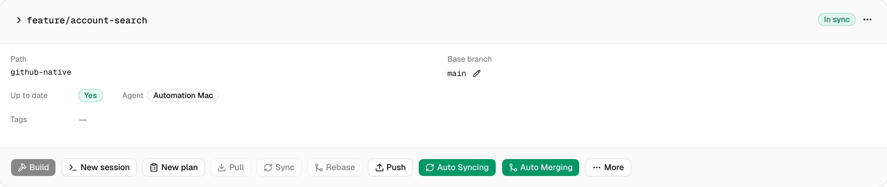
  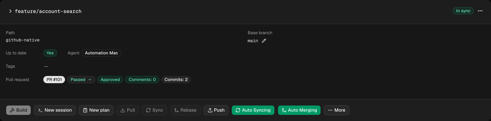
</Frame>

Optional follow-ups:

- **Delete this worktree after the pull request merges**.
- **Move the linked Jira ticket to the project's configured done status**.
- **Update targeting worktrees**: select dependent checkouts to receive this worktree's effective base after the merge.

<Frame>
  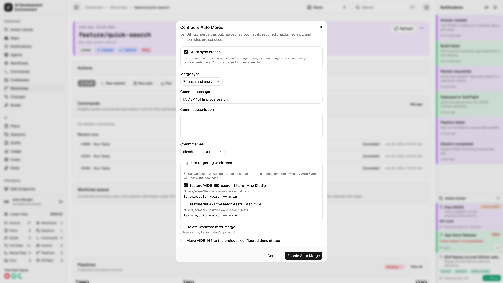
  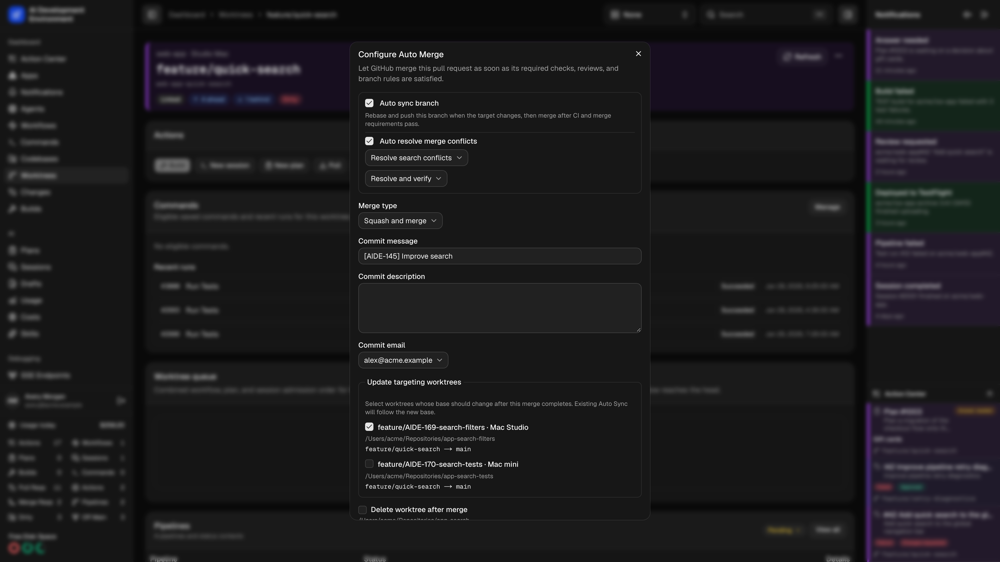
</Frame>

Targeting worktrees include checkouts on other agents for the same canonical repository, including checkouts whose base is inherited from their codebase. New checkboxes are unchecked; editing a saved configuration restores your selections. The destination is fixed when you save, even if the parent worktree's base later changes.

Updates run only after the provider confirms the merge and before parent-worktree cleanup. Changed or removed targets are skipped and their outcomes are recorded. Retry follow-ups after fixing an error; completed steps do not overwrite subsequent edits. These are base-setting updates, so existing **Auto Sync** can use the new base afterward. GitHub and GitLab manual merge dialogs and the native iOS app offer the same controls.

### Sync the branch before merging

Select **Auto sync branch**, review the displayed source commit, choose the merge options and follow-ups, then enable Auto Merge. The setting defaults to off. It requires a matching linked worktree and an updated agent advertising `worktree.auto-sync.reviewed-head`.

The control plane saves the operation before starting Git work. The agent verifies the reviewed local and remote source revision, rebases onto the request's actual target repository and branch, and pushes with an explicit force-with-lease. Fork targets are supported. Changing the worktree's configured base does not change this operation's merge target.

After syncing, the control plane waits for successful CI associated with the resulting source revision and for the provider's merge requirements. An older green pipeline, missing CI, pending or failed checks, cancellation, or skipped-only CI cannot authorize the merge. If the target advances while waiting, the control plane syncs again and checks CI for the resulting revision. Native auto-merge stays disabled during this managed flow.

Git work waits when another operation holds a conflicting resource and resumes automatically when it can proceed. The same applies to merge submission and worktree cleanup after merging. Temporary resource contention does not require **Resume Auto Merge**. Existing operations paused solely by the earlier codebase-contention error recover automatically after the control plane revalidates their saved identities.

| Progress | Meaning |
| --- | --- |
| **Syncing branch** | A saved sync request is waiting for the agent or running a guarded rebase and push. |
| **Resolving merge conflicts** | The selected workflow is running on the paused rebase. |
| **Waiting for CI** | The current source revision still needs passing CI. |
| **Waiting for merge requirements** | CI passed, but provider readiness, approvals, or branch rules still block merging. |
| **Merging** | The control plane submitted the merge and is awaiting confirmation. |
| **Action required** | Review and resolve the displayed problem before resuming. |

Enable **Auto resolve merge conflicts** under **Auto sync branch** and choose an eligible merge conflict workflow. If the workflow offers trigger choices, choose the one you want to run. This option requires an agent that supports guarded conflict resolution. The control plane runs the workflow once when its rebase hits a conflict. Configure it to resolve the local rebase and leave the push to Auto Merge. When the workflow succeeds, the agent verifies the resolved rebase and pushes with the original source lease. Auto Merge then waits for CI and the provider's rules on the resolved commit.

With **Auto resolve merge conflicts** off, resolve any rebase manually, finish and push it, then refresh the merge options, review the current source commit, and choose **Resume Auto Merge**. A failed workflow, unresolved conflicts, changed source or target revisions during resolution, or preparations blocking the rebase also pause the operation. The agent does not force through preparations. CI retries remain available through the existing pipeline controls.

**Cancel Auto Merge** cancels pending sync and conflict workflow work and prevents further merge attempts. A rebase already pushed is preserved. If the provider already accepted the merge, the control plane confirms it and handles the saved follow-ups. Closing the web or iOS app does not stop a saved operation. Standalone **Auto Sync** keeps its configuration while the merge operation coordinates access to the worktree.

The native iOS merge sheets expose the same setting, eligibility reason, progress, cancellation, and resume controls. After updating the control plane, apply its database migrations and update the control agents before using branch syncing.

GraphQL callers set `autoSync: true` on `ConfigureWorktreeAutoMergeInput` for GitHub and also provide the reviewed `expectedHeadSha`. GitLab callers set `autoMerge: true` and `autoSync: true` on `SubmitGitLabMergeRequestMergeInput`, retaining its required reviewed `sha`. Set `conflictWorkflowId` to opt into conflict resolution and provide `conflictWorkflowChoice` when the trigger requires a choice. Merge options include the eligible `mergeConflictWorkflows` and the saved defaults. Saved operations expose `autoSync` and their current `state`.

Enabling worktree **Auto Merge** moves linked Jira tickets to the project’s configured **Auto merge status**, when set. If Jira rejects that transition, auto merge stays enabled and a warning explains that the ticket still needs attention. Saving an already-enabled operation does not repeat the transition.

Auto Merge reports **Auto Merge complete** after merging and completing its selected follow-ups. Retry unfinished follow-ups after fixing their error; this does not submit another merge.

When **Move ticket to done** is selected, both **Merge** and **Auto Merge** move linked Jira tickets to **Auto merge done status** after the provider confirms the merge. An unset status skips the transition. Failed merges leave Jira unchanged.

## Moving a worktree to another agent

Moving pushes the branch from the source agent and checks it out on the destination.

<Steps>
  <Step title="Pick a destination" icon="laptop">
    Choose the destination agent and checkout, then either create a new worktree there or target an existing one. A destination with uncommitted changes is flagged — Git will carry them onto the incoming branch where it can.
  </Step>
  <Step title="Decide about the source" icon="trash">
    **Delete old worktree after moving** cleans up the source. Primary worktrees cannot be deleted, so the option is unavailable for them.
  </Step>
  <Step title="Watch it run" icon="chart-line">
    The move reports its stage: pushing the source branch, checking out the destination, waiting for a stash decision, removing the old worktree, then complete.
  </Step>
</Steps>

If destination changes block the branch switch, choose **Stash and continue** — the destination's tracked and untracked changes are stashed, the move continues, and the stash is left for manual restoration. **Cancel move** stops it; the source branch stays pushed and the source worktree is kept.

<Note>
  A move is refused up front when the source agent is offline or too old, another operation is active for the repository, HEAD is detached, the source is dirty, the branch is behind or diverged from origin, or no compatible destination exists. The page names the specific reason.
</Note>

## Deleting a worktree

**Delete worktree** permanently removes the folder and its local branch, optionally deleting `origin/<branch>` too. The repository default branch is protected from remote deletion.

<Warning>
  All staged, unstaged, and untracked changes in the worktree are permanently lost. There is no stash-first option on delete.
</Warning>

## Hidden worktrees

Deleting a worktree also removes Xcode build data associated with that checkout when it exists, using an updated macOS agent with the cleanup capability. Older agents retain their existing deletion behavior. Cleanup targets the deleted checkout’s data. If checkout deletion succeeds but Xcode cleanup fails, a notification links to the deletion job so you can inspect the warning and remove the remaining data.

A worktree that disappears from disk is not deleted immediately — it moves to **Hidden** and is retained for seven days. If the agent rediscovers it in that window, its saved metadata, tags, and highlight come back. **Purge** and **Purge all** remove hidden entries early.

## Related pages

<Columns cols={2}>
  <Card title="Worktree details" icon="code-branch" href="/worktrees/worktree-detail">
    Overview, working tree, branch changes, diffs, and coverage.
  </Card>
  <Card title="Codebases" icon="folder-tree" href="/codebases/codebases">
    The repositories and checkouts worktrees are created from.
  </Card>
</Columns>

## Build and path shortcuts

Select an **Out of date** build badge for a **Rebuild** menu. The action refreshes the current surface and reports failures there. **Copy path** in the worktree actions copies the full worktree folder path, including its parent directories.

The Start Build sheet keeps destination tabs, device selection, and scripts visible. Expand **Details** for the remaining settings and command preview. Valid configurations use green badges.

## Bulk Sync

<Frame>
  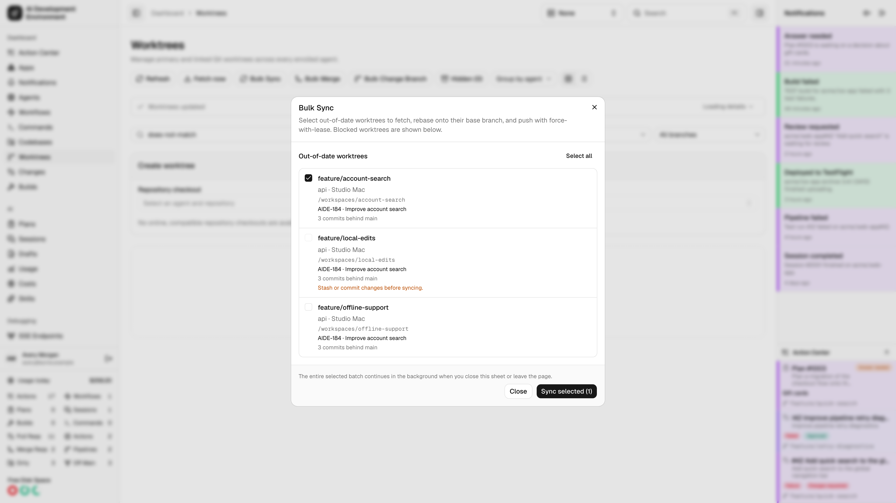
  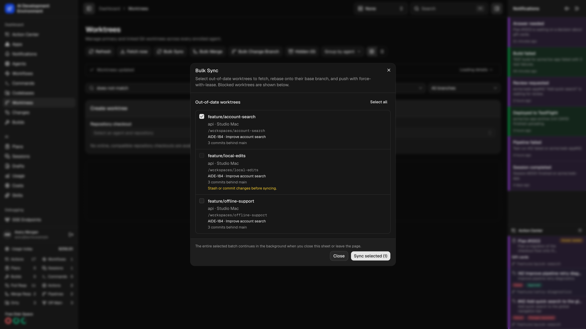
</Frame>

Select **Bulk Sync** beside **Fetch now** on Worktrees or an app's Worktrees tab to review outdated worktrees before syncing. The centered web sheet includes every outdated worktree in that page's app or global scope and respects Active Agent. List search, repository, changes, and branch filters do not exclude checkouts from the bulk sheet.

Default branches are excluded from Bulk Sync; use repository **Keep default branches up to date** for their same-named remote updates. Eligible worktrees start checked. Uncheck any checkout to exclude it. Each row shows its branch, repository, agent, base branch, and commits behind; blocked checkouts remain visible with their reason and cannot be selected. Choose **Sync selected** to start the batch. Sync uses the existing worktree sync behavior and does not enable Auto Sync.

The control plane continues the batch after you close the sheet or navigate away. Sync requests for the same worktree run serially; independent worktrees can progress concurrently on updated agents, subject to resource conflicts. Older agents retain codebase-wide serialization. Reopen the active batch from Worktrees to see pending, running, succeeded, failed, skipped, and attention-required outcomes. One failure does not stop independent worktrees. Pending checkouts whose agent goes offline are skipped with a reason. If an agent disconnects after a job is submitted, that job remains active until the agent reports its terminal recovery result; its protected resources stay reserved until cleanup is verified. Address conflicts and preparation issues through the worktree's existing recovery actions.

<Frame>
  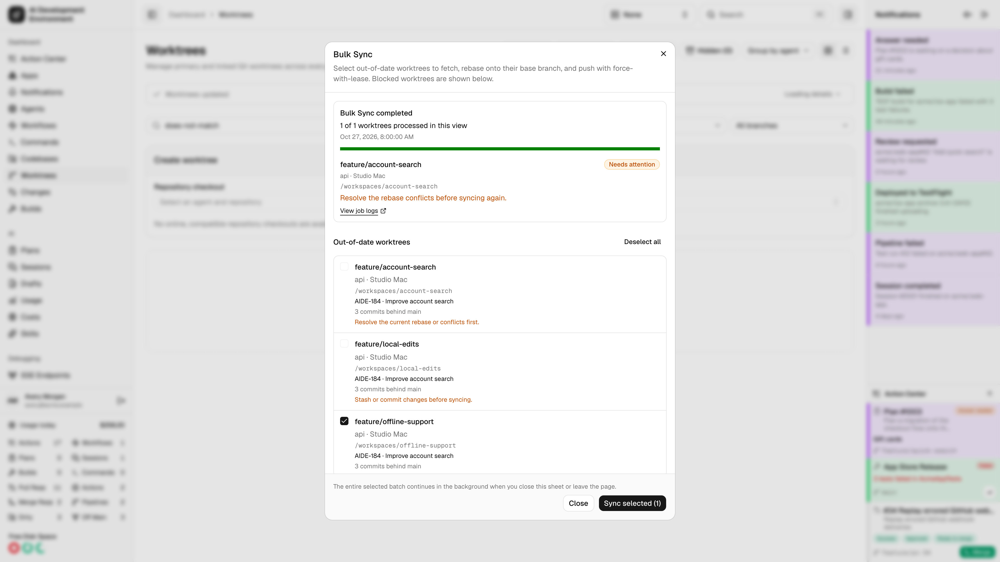
  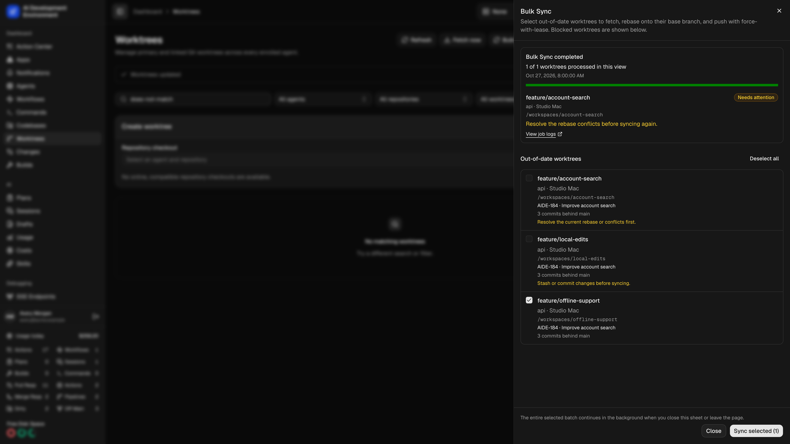
</Frame>

The native iOS app offers the same selection and progress sheets from global and app-scoped Worktrees. API clients can start a batch with `startWorktreeSyncBatch`, inspect `worktreeSyncBatch`, and rediscover running batches through `worktreeOverview.activeSyncBatches`.

## Bulk Merge

Select **Bulk Merge** beside **Bulk Sync** on Worktrees or an app’s Worktrees tab. The web and iOS sheets use the current app and **Active Agent** scope. Search and display filters on the Worktrees list do not change which checkouts appear in the sheet.

<Frame>
  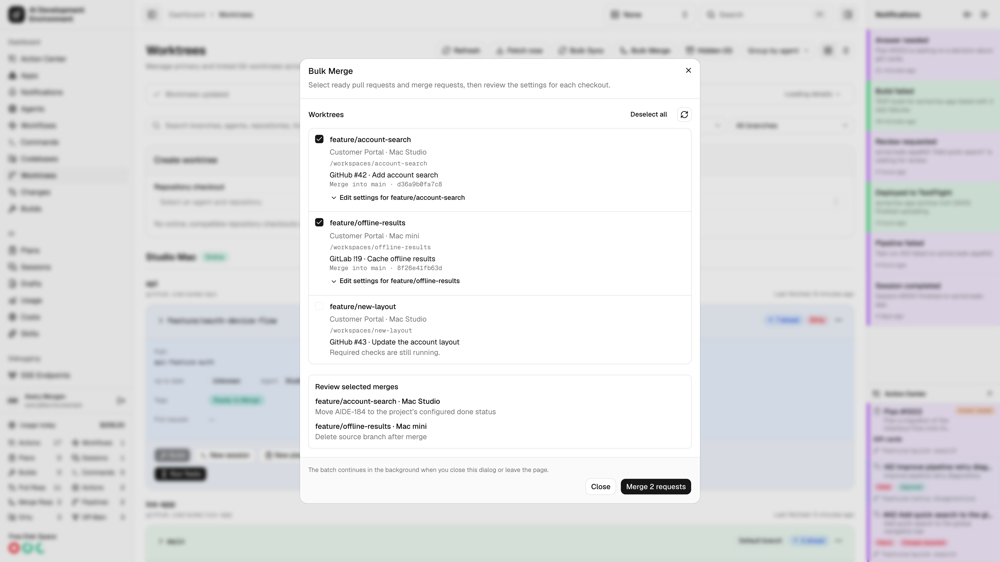
  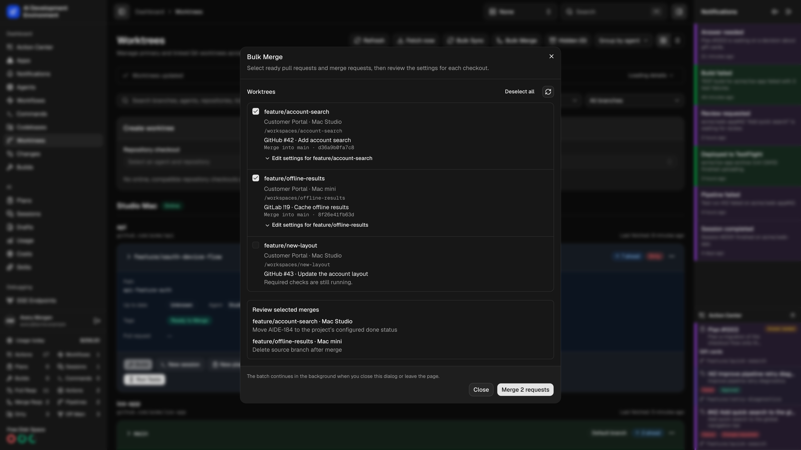
</Frame>

1. Select individual requests or use **Select all ready**. The sheet starts with nothing selected. If a PR or MR appears on more than one checkout, select the checkout that should receive the local follow-ups.
2. Open a row’s merge settings to review its commit options and follow-ups. Each row starts with the single-merge defaults for that request. Changes apply to this batch.
3. Review the selected follow-ups and choose **Merge N requests**. The control plane checks each request again before submitting it. If a source commit, target branch, or merge requirement changes, the control plane skips that row and continues the batch.

Blocked requests show their reason in the review sheet. A draft, pending checks, missing approval, or an existing merge operation may make a request unavailable.

The batch continues on the control plane after you close the sheet. Reopen Bulk Merge to see progress and the latest results. A confirmed merge can have a separate follow-up warning, such as a checkout that could not be deleted. Review an unconfirmed result on the provider before trying it again.

<Frame>
  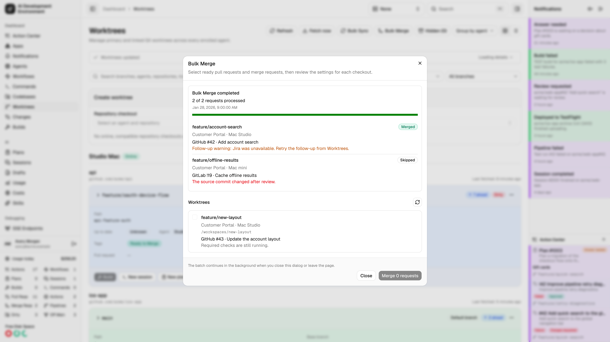
  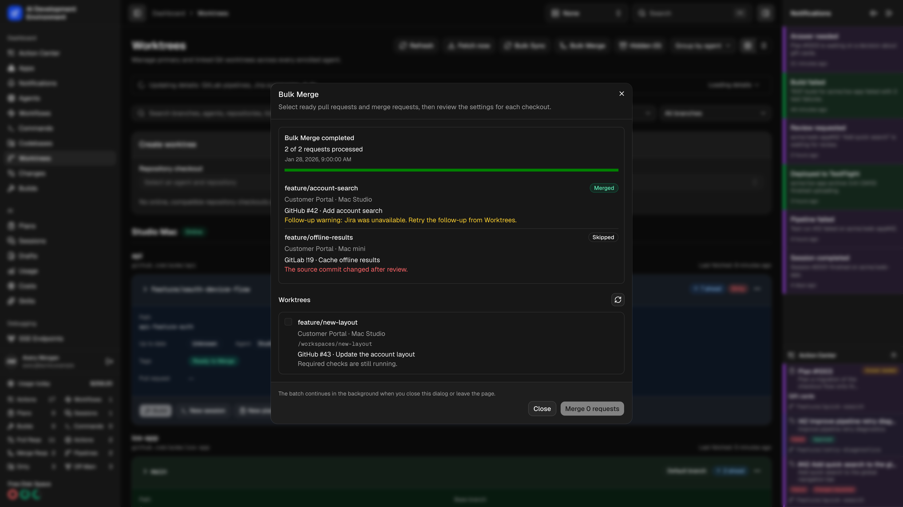
</Frame>

GraphQL clients can use `worktreeMergeCandidates` to review readiness, `startWorktreeMergeBatch` to submit a selection, and `worktreeMergeBatch` or `worktreeMergeBatches` to read progress. Reuse the same request ID to recover the result of an interrupted submission for the same scope and settings.
